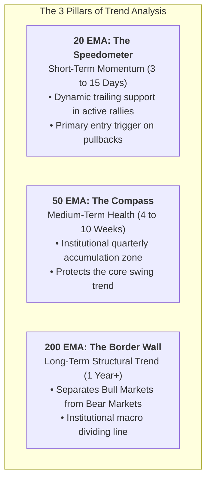
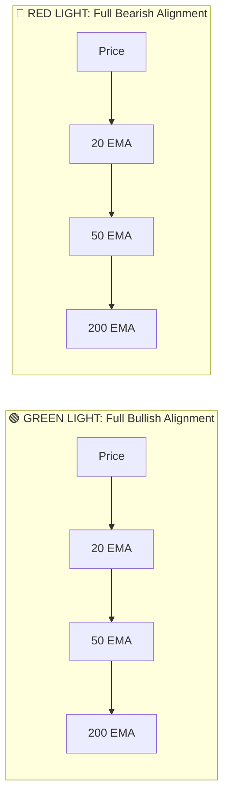
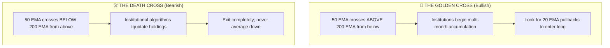

# The Complete Guide to 20 / 50 / 200 EMA

The Exponential Moving Average (EMA) is one of the most powerful and widely used technical indicators among institutional fund managers and professional swing traders.

---

## 1. What is an EMA (Exponential Moving Average)?

An **EMA** calculates the average closing price of a stock over $N$ trading sessions, but with a critical difference compared to a Simple Moving Average (SMA):
* An **SMA (Simple Moving Average)** treats every day equally. Day 1 has the exact same weight as Day 50.
* An **EMA (Exponential Moving Average)** applies a mathematical weighting multiplier that gives **greater significance to recent price action**.

$$\text{EMA Multiplier} = \frac{2}{N + 1}$$
* For a **20 EMA**, the recent day's price carries **9.52%** weight.
* For a **50 EMA**, recent price carries **3.92%** weight.
* For a **200 EMA**, recent price carries **0.995%** weight.

**Why this matters:** Because the EMA reacts faster to real-time price changes, it flags trend reversals and pullbacks days before an SMA notices them.

---

## 2. The Roles of 20, 50, and 200 EMA

---

### 1. The 20 EMA: Short-Term Momentum & Pullback Entry
* **Timeframe:** ~1 month of trading data (20 sessions).
* **Role:** Shows the immediate speed and strength of the current swing leg.
* **In a Strong Uptrend:** Price rides above the 20 EMA without closing below it.
* **How Swing Traders Use It:** 
  * In a raging bull stock (like *Eternal/Zomato*), you never wait for a deep crash. You buy shallow pullbacks that touch and reject the rising **20 EMA**.
  * Use the daily close below 20 EMA as your **trailing stop-loss trigger** to lock in profits.

---

### 2. The 50 EMA: Intermediate Swing Trend & Mutual Fund Support
* **Timeframe:** ~1 financial quarter (~10 weeks / 50 sessions).
* **Role:** Reflects institutional quarterly positioning.
* **How Swing Traders Use It:**
  * When a stock experiences a healthy 5% to 8% market correction in an ongoing uptrend, it almost always lands on the rising **50 EMA**.
  * Mutual funds defend the 50 EMA. A bounce off the 50 EMA with expanding volume gives one of the highest risk/reward swing entries in the stock market (e.g., our trade setup in *Sun Pharma*).

---

### 3. The 200 EMA: The Institutional "Bull vs. Bear" Border
* **Timeframe:** ~1 calendar year (~200 trading sessions).
* **Role:** The ultimate baseline used by every pension fund, hedge fund, and foreign institutional investor (FII) on Wall Street and Dalal Street.
* **The Golden Rule:**
  * **Price > 200 EMA:** The stock is in an **Institutional Bull Market**. Only take LONG swing trades.
  * **Price < 200 EMA:** The stock is in an **Institutional Bear Market**. Avoid buying or holding swing trades!

---

## 3. The 3-EMA Alignment System (The Traffic Light)

By glancing at the order of the 20, 50, and 200 EMAs on a Daily chart, you instantly know whether to buy, stay in cash, or exit:

### Scenario 1: Perfect Bullish Alignment (Stage-2 Mark-Up)
$$\text{Price} > \text{20 EMA} > \text{50 EMA} > \text{200 EMA}$$
* **What it means:** All moving averages are fanning out upward like parallel lanes on a highway.
* **Psychology:** Short-term, medium-term, and long-term traders are all sitting on profits. No overhead supply.
* **Real Portfolio Example:** **`ETERNAL` (Zomato)**
  * LTP is ₹342.50.
  * 20 EMA is ₹326.
  * 50 EMA is ₹308.
  * 200 EMA is ₹242.
  * *Result:* The stock generated **+34.59% profit** effortlessly because the entire moving average structure propelled price higher.

---

### Scenario 2: Perfect Bearish Alignment (Stage-4 Mark-Down)
$$\text{Price} < \text{20 EMA} < \text{50 EMA} < \text{200 EMA}$$
* **What it means:** All moving averages are fanning downward.
* **Psychology:** Every single trader who bought over the last year is sitting on losses. Whenever price tries to bounce, trapped buyers sell to get their money back, creating a wall of overhead supply.
* **Real Portfolio Example:** **`SJVN`**
  * LTP is ₹53.63.
  * 20 EMA is ₹62.00.
  * 50 EMA is ₹74.00.
  * 200 EMA is ₹98.00.
  * *Result:* Down **-53.36%**. Every single bounce failed because the EMAs acted as concrete ceilings overhead.

---

## 4. Key Moving Average Signals: Golden Cross vs. Death Cross

| Signal | 50 EMA vs. 200 EMA | Market Condition | Practical Action |
| :--- | :--- | :--- | :--- |
| **Golden Cross 🌟** | 50 EMA crosses **ABOVE** 200 EMA | Long-term trend shifts from Bear to **Bull**. | Aggressively hunt for swing breakout and pullback entries. |
| **Death Cross ☠️** | 50 EMA crosses **BELOW** 200 EMA | Long-term trend shifts from Bull to **Bear**. | Liquidate swing holdings; move capital to cash or market leaders. |

---

## 5. Practical Swing Trading Tactics Using EMAs

### Tactic 1: The 20 EMA Dynamic Trailing Stop
1. Enter a high-momentum breakout stock (e.g., *Bharti Airtel* at ₹1,965).
2. As the stock climbs to ₹2,050, ₹2,150, do not guess where the peak is.
3. Every evening after market close, look at where the **20 EMA** is sitting.
4. Keep shifting your stop-loss order up to just below the rising 20 EMA.
5. Exit ONLY when a daily candle **closes below the 20 EMA**. This allows you to capture 80% to 90% of massive multi-month winning trends without getting shaken out prematurely.

---

### Tactic 2: Buying the 50 EMA Institutional Dip
1. Identify a top-tier market leader that has pulled back 5% to 8% with declining volume (e.g., *Sun Pharma*).
2. Check if the stock is touching its rising 50 EMA.
3. Wait for a **reversal candle** (Hammer or Bullish Engulfing) to form on top of the 50 EMA.
4. Enter on the break of that candle's high with stop-loss placed 0.5% below the 50 EMA.
5. This yields low-risk entries with a 1:3 or 1:4 Risk/Reward ratio.

---

### Tactic 3: Never Buy When Bouncing Into a Downward 20/50 EMA
* If a stock is trading below its 20 and 50 EMA (like *Suzlon* or *Yes Bank*), an intraday green candle is usually an **institutional exit trap**.
* The declining EMA acts as a **moving ceiling of resistance**. As soon as price touches the 20 EMA, big players sell, driving price down to lower lows.

---

## Summary Cheat Sheet

| EMA | Time Horizon | Primary Function in Trading | Golden Rule |
| :---: | :---: | :--- | :--- |
| **20 EMA** | Short-Term (3–15 Days) | Riding fast momentum & trailing stop-loss | In an uptrend, stay long as long as price stays above 20 EMA. |
| **50 EMA** | Medium-Term (4–10 Weeks) | Institutional pullback support shelf | Best low-risk swing entries occur on 50 EMA bounces. |
| **200 EMA** | Long-Term (1 Year+) | The Bull / Bear Macro Dividing Line | **Never buy or hold a swing trade below the 200 EMA.** |
