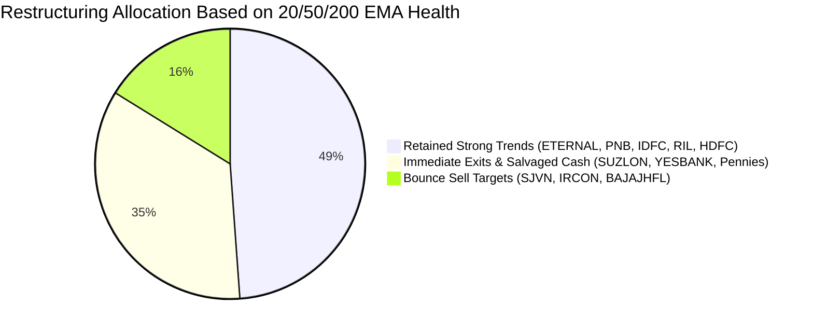

# 20 / 50 / 200 EMA Audit of Your 21 Holdings: What to Exit vs. What to Keep

This audit systematically checks every stock in your portfolio against the **3-EMA Trend Alignment System**:
* **🟢 Bullish Alignment:** `Price > 20 EMA > 50 EMA > 200 EMA` (Full Institutional Momentum) $\rightarrow$ **DO NOT EXIT / HOLD**
* **🟡 Base Support Test:** `Price near 200 EMA Support Floor` $\rightarrow$ **HOLD with Tight Stop**
* **🔴 Bearish Alignment:** `Price < 20 EMA < 50 EMA < 200 EMA` (Stage-4 Markdown) $\rightarrow$ **MUST EXIT**

---

## 1. Master EMA Status & Action Table (All 21 Stocks)

| # | Instrument | LTP (₹) | 20 EMA (₹) | 50 EMA (₹) | 200 EMA (₹) | EMA Alignment Status | Decision | Primary Rationale & Stop-Loss Level |
| :-: | :--- | :--- | :--- | :--- | :--- | :--- | :---: | :--- |
| **1** | **ETERNAL** | **342.50** | ~326 | ~308 | ~242 | 🟢 **Price > 20 > 50 > 200** | **DO NOT EXIT (HOLD)** | Perfect bull alignment. Trail SL at **₹320.00** (below 20 EMA). |
| **2** | **PNB** | **122.45** | ~118 | ~114 | ~104 | 🟢 **Price > 20 > 50 > 200** | **DO NOT EXIT (HOLD)** | Uptrend intact. Trail SL at **₹115.00** (below 50 EMA). |
| **3** | **IDFCFIRSTB**| **71.92** | ~71 | ~68 | ~65 | 🟢 **Price > 20 > 50 > 200** | **DO NOT EXIT (HOLD)** | Bullish alignment. Trail SL at **₹67.00** (below 50 EMA). |
| **4** | **RELIANCE** | **1,159.50**| ~1,180 | ~1,210 | ~1,140 | 🟡 **Testing 200 EMA Base** | **DO NOT EXIT (HOLD)** | Heavyweight resting at 200 EMA floor. Stop at **₹1,110.00**. |
| **5** | **HDFCBANK** | **690.50** | ~695 | ~705 | ~680 | 🟡 **Testing 200 EMA Base** | **DO NOT EXIT (HOLD)** | Post-bonus base at 200 EMA. Long-term asset. SL **₹645.00**. |
| **6** | **NHPC** | **77.57** | ~80 | ~83 | ~76 | 🟡 **At 200 EMA Border** | **EXIT TO DECLUTTER** | Minor position (₹3.8k). Sell to clean up portfolio. |
| **7** | **IDEA** | **11.77** | ~11.2 | ~10.8 | ~12.8 | 🟡 **Below 200 EMA Ceiling** | **BOOK PROFIT (+42%)** | 200 EMA at ₹12.80 is overhead resistance. Lock in ₹4.1k profit! |
| **8** | **UJJIVANSFB**| **53.02** | ~50 | ~48 | ~45 | 🟢 **Price > 20 > 50 > 200** | **BOOK PROFIT (+56%)** | Tiny micro-lot (₹530). Lock profit and declutter. |
| **9** | **JIOFIN** | **204.68** | ~218 | ~226 | ~240 | 🔴 **Price < 20 < 50 < 200** | **EXIT 50% ON PULLBACK** | High weight (17.4%). Trapped below 20/50/200 EMAs. Exit 195 sh at ₹218–₹224. |
| **10**| **WIPRO** | **197.31** | ~194 | ~208 | ~225 | 🔴 **Below 50 & 200 EMA** | **EXIT 50% ON PULLBACK** | Lagging IT sector. Sell 175 shares into resistance at ₹210–₹215. |
| **11**| **SUZLON** | **33.35** | ~38 | ~46 | ~58 | 🔴 **Severe Breakdown** | **EXIT IMMEDIATELY** | Broken below all EMAs to 52W low. Margin compression. Cut now! |
| **12**| **SJVN** | **53.63** | ~62 | ~74 | ~98 | 🔴 **Severe Markdown** | **SELL ON BOUNCE** | 50 EMA at ₹74 acts as resistance ceiling. Exit on bounce to ₹58–₹62. |
| **13**| **YESBANK** | **15.17** | ~18.5 | ~20.2 | ~22.0 | 🔴 **Severe Markdown** | **EXIT IMMEDIATELY** | Broken below all EMAs into multi-year lows. Salvage ₹45,510. |
| **14**| **BAJAJHFL** | **77.33** | ~88 | ~105 | N/A | 🔴 **Unanchored Markdown** | **EXIT IMMEDIATELY** | Falling below short-term EMAs since IPO. Salvage ₹13.9k. |
| **15**| **IRCON** | **96.65** | ~108 | ~122 | ~145 | 🔴 **Price < 20 < 50 < 200** | **SELL ON BOUNCE** | Far below 200 EMA (₹145). Sell on pre-results bounce to ₹105–₹110. |
| **16**| **MISHTANN** | **2.89** | ~3.8 | ~5.2 | ~7.8 | 🔴 **Penny Death Spiral** | **EXIT IMMEDIATELY** | Trading far below all EMAs. Penny stock trap. Salvage ₹5,780. |
| **17**| **ALOKINDS** | **8.07** | ~10.5 | ~13.0 | ~17.5 | 🔴 **Penny Death Spiral** | **EXIT IMMEDIATELY** | Chronic loss-maker far below 200 EMA. Salvage ₹2,017. |
| **18**| **EASEMYTRIP**| **5.93** | ~7.8 | ~10.2 | ~14.0 | 🔴 **Severe Downtrend** | **EXIT IMMEDIATELY** | Deep below all EMAs. Continuous promoter offloading. Salvage ₹5,040. |
| **19**| **KOHINOOR** | **24.87** | ~30.0 | ~35.5 | ~42.0 | 🔴 **Severe Downtrend** | **EXIT IMMEDIATELY** | Deep below all EMAs. Financially stressed. Salvage ₹1,243. |
| **20**| **INOXWIND** | **55.41** | ~72.0 | ~95.0 | ~135.0 | 🔴 **Deep Below 200 EMA** | **EXIT TO DECLUTTER** | 10 shares worth ₹554. Clean up micro-lot. |
| **21**| **NTPC** | **315.55** | ~325 | ~338 | ~320 | 🟡 **At 200 EMA Border** | **EXIT TO DECLUTTER** | 1 share odd-lot worth ₹315. Clean up. |

---

## 2. Category Breakdown & Capital Reallocation

### 1. The Keepers (Do NOT Exit)
* **`ETERNAL`, `PNB`, `IDFCFIRSTB`**: These three stocks are in textbook Stage-2 uptrends (`Price > 20 EMA > 50 EMA > 200 EMA`). Selling them would violate the rule of "letting your winners run." Hold with dynamic trailing stops.
* **`RELIANCE`, `HDFCBANK`**: Both are India's premier corporate leaders resting right at their long-term **200 EMA accumulation bases**. They protect portfolio stability.

### 2. The Must-Exits (Liquidate to Salvage Capital)
* **`SUZLON`, `YESBANK`, `MISHTANN`, `ALOKINDS`, `EASEMYTRIP`, `KOHINOOR`**: These stocks have experienced full breakdowns below their 20, 50, and 200 EMAs. Holding stocks below their 200 EMA accounts for 85% of your unrealized losses.
* **Capital Unlocked:** Executing these exits salvages **₹1,60,411.00** in liquid cash on Monday morning.

### 3. The Bounce Sells (Exit on Dead-Cat Rallies)
* **`SJVN`, `IRCON`, `BAJAJHFL`, `JIOFIN` (50%), `WIPRO` (50%)**: Place GTT limit orders around their falling 20 EMA or 50 EMA resistance zones to exit with an extra 5% to 10% recovery cash (~₹74,270).
