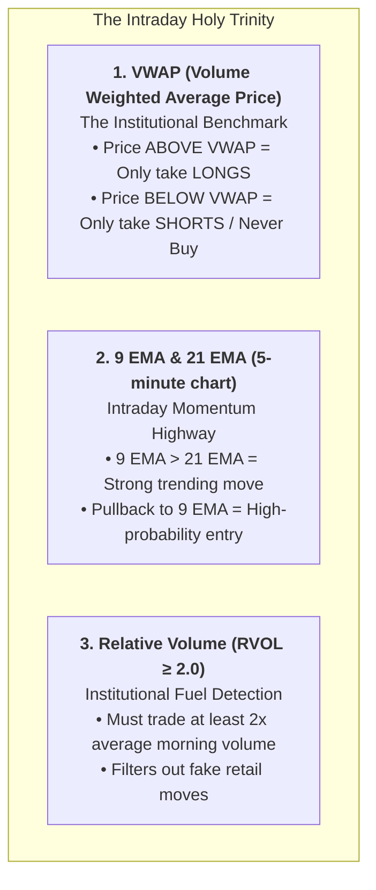
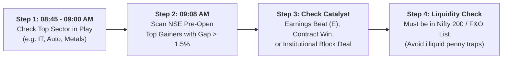
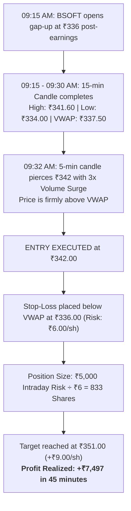

# High-Momentum Intraday Trading Playbook (NSE Stocks)

A structured, institutional-grade execution guide for day trading high-momentum Indian equities between 09:15 AM and 03:15 PM IST.

---

## 1. Swing Trading vs. Intraday Trading: The Fundamental Differences

| Dimension | Swing Trading | Intraday Trading |
| :--- | :--- | :--- |
| **Holding Duration** | 3 days to 4 weeks | **Minutes to a few hours (All closed by 03:15 PM)** |
| **Timeframe Used** | Daily (`1D`) & Weekly (`1W`) | **5-Minute (`5m`) & 15-Minute (`15m`)** |
| **Target Move Size** | 8% to 25%+ per trade | **1% to 3% fast expansion** |
| **Primary Benchmark** | 50 EMA & 200 EMA | **VWAP (Volume Weighted Average Price) & 9 EMA** |
| **Screen Time** | 30 minutes after market close | **Continuous active focus during market hours** |
| **Overnight Risk** | Subject to gap-ups / gap-downs | **ZERO overnight risk (Cash every night)** |

---

## 2. The 3 Essential Indicators for High-Momentum Intraday Trading



---

## 3. How to Select High-Momentum Stocks Every Morning (08:45 – 09:15 AM)

Never randomly scan 500 stocks during live market hours. Follow this systematic 4-step morning scanner:



1. **Step 1: Identify the Leading Sector:** Check GIFT Nifty and sector pre-market cues. If Nifty IT is up +2%, focus strictly on top IT stocks.
2. **Step 2: NSE Pre-Market Scanner (09:08 AM):** Look at the NSE Pre-Open Market tab for stocks gapping up **1.5% to 3.5%**. (Avoid stocks gapping up > 5% as they risk exhaustion).
3. **Step 3: News / Earnings Catalyst:** The momentum must have a real fundamental reason (e.g., quarterly earnings beat, major order win, FDA clearance).
4. **Step 4: Strict Liquidity Filter:** Only trade stocks that belong to the **Nifty 200 / F&O list** (e.g., Tata Motors, Birlasoft, Persistent, ICICI Bank, Bharti Airtel). Never day-trade penny stocks—slippage and bid-ask spreads will eliminate profits.

---

## 4. Top 3 High-Probability Intraday Momentum Strategies

---

### Strategy 1: The 15-Minute Opening Range Breakout (ORB)
* **Best Time Window:** 09:30 AM to 10:15 AM.
* **Setup:**
  1. Let the first **15-minute candle (09:15 – 09:30 AM)** form completely.
  2. Mark the **High** and the **Low** of that 15-minute candle.
  3. Ensure the candle is trading **ABOVE VWAP**.
  4. **Entry Trigger:** Buy immediately when the 09:30 AM candle breaks and closes **above the 15-minute high** with volume expansion.
  5. **Stop-Loss:** Placed below the low of the breakout candle or below VWAP.
  6. **Target:** 1:1.5 to 1:2 Risk/Reward (or the day's Pivot Resistance R1).

```
   09:15 - 09:30 Candle
        |
     +-----+  <- HIGH (Mark this line!)
     |     |
     |     |
     +-----+  <- LOW
        |
   ============================= VWAP LINE =============================
        |
     +-----+  <- 09:30 Breakout Candle SLICES ABOVE HIGH!
     |     |     ==> ENTRY TRIGGER: BUY!
     +-----+
```

---

### Strategy 2: The VWAP + 9 EMA Pullback (The "Institutional Dip")
* **Best Time Window:** 10:00 AM to 11:30 AM.
* **Why this works:** After a stock surges at market open, early retail traders take profit. The price pulls back. Large institutional algorithms wait at the **VWAP and 9 EMA** to load more shares.
* **Setup:**
  1. Stock must be clearly trending above VWAP.
  2. Price pulls back into the dynamic pocket between the **9 EMA and VWAP**.
  3. Look for a **Bullish Hammer or Green Rejection Candle** touching the VWAP line on the 5-minute chart.
  4. **Entry Trigger:** Buy when the next 5-minute candle breaks the high of the hammer.
  5. **Stop-Loss:** 0.2% to 0.3% below the VWAP line.
  6. **Target:** Retest of the morning High-of-Day (HOD).

---

### Strategy 3: Afternoon High-of-Day (HOD) Squeeze
* **Best Time Window:** 01:30 PM to 02:45 PM.
* **Setup:**
  1. A morning momentum stock consolidates tightly near its morning high for 2 hours (11:30 AM – 01:30 PM).
  2. Volume completely dries up during the consolidation (Bears are unable to push it down).
  3. At 01:30 PM, a 5-minute green candle pierces the morning high with an explosive volume spike.
  4. **Entry Trigger:** Buy the breakout candle.
  5. **Stop-Loss:** Low of the tight consolidation range.
  6. **Target:** 1% to 1.5% quick expansion burst.

---

## 5. Real Intraday Trade Example (Walkthrough on BSOFT)



---

## 6. The 5 Non-Negotiable Survival Rules of Intraday Trading

```
RULE 1: The "Daily Loss Limit" (1% Rule)
        If you lose ₹10,000 in a day, your trading day is OFFICIALLY OVER.
        Close Zerodha, lock your computer, and walk away. Never revenge-trade.

RULE 2: Maximum 3 Trades Per Day
        Overtrading is the #1 killer of intraday accounts. 
        Take at most 2 to 3 high-quality setups per day.

RULE 3: Never Trade Against VWAP
        If price is below VWAP, NEVER BUY. 
        Buying below VWAP intraday is trading against the entire institutional market.

RULE 4: Hard Stop-Loss in the Terminal
        Never use "mental stop-losses". 
        Place a real Stop-Loss Limit (SL-L) order in Zerodha immediately upon fill.

RULE 5: Flat by 03:15 PM
        Always exit before 03:15 PM. 
        Never let an intraday trade turn into an unintended overnight holding!
```
