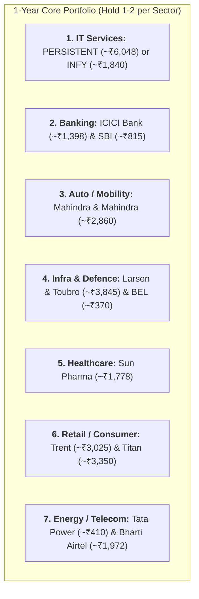
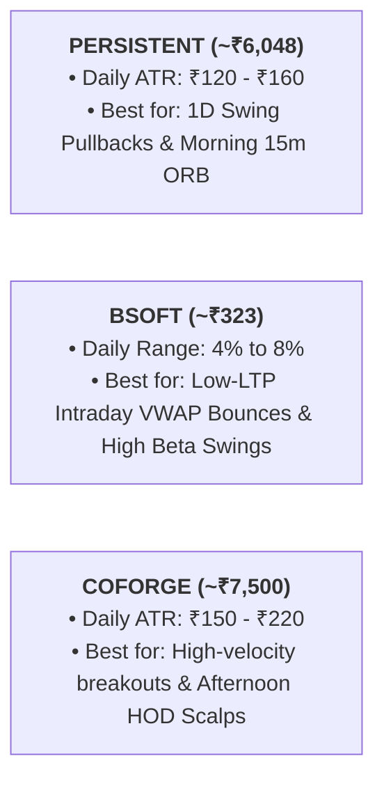
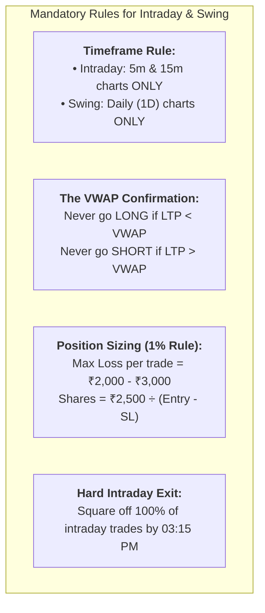

# Master Stock Selection: 1-Year Long-Term Holdings vs. High-Momentum Intraday/Swing Plays

A dual-track equity blueprint designed for two distinct market objectives:
1. **Track 1:** 1-Year Core Compounders (Low Stress, High Business Quality, 1 per sector)
2. **Track 2:** High-Momentum Intraday & Swing Movers (High ADR/ATR, High Beta, Liquid Low-LTP stocks under ₹500)

---

## 🏛️ Track 1: Best Stocks for 1-Year Long-Term Holding (Sector-by-Sector)

For a 1-year investment horizon, you want companies with accelerating earnings growth (PAT CAGR > 15–20%), dominant market shares, and institutional backing.

### 1-Year Expected Catalysts & Valuation Matrix:

| Sector | Top Stock | CMP (₹) | 1-Year Target View | The Core 1-Year Fundamental Catalyst |
| :--- | :--- | :---: | :---: | :--- |
| **Banking** | **`ICICIBANK`** | ~₹1,398 | **₹1,650 – ₹1,700** | Industry-leading 2.3% RoA, sub-0.5% Net NPA, consistent 16% credit growth. |
| **PSU Banking** | **`SBIN`** | ~₹815 | **₹960 – ₹1,000** | Cheapest large bank in India (P/E ~10.5x), prime beneficiary of corporate capex. |
| **IT Services** | **`PERSISTENT`** | ~₹6,048 | **₹7,200 – ₹7,500** | +30.3% YoY revenue surge, record $633M TCV deal pipeline, Enterprise AI leadership. |
| **Automobile** | **`M&M`** | ~₹2,860 | **₹3,350 – ₹3,500** | #1 SUV market share, multi-month order book, expanding tractor margins. |
| **Infra / EPC** | **`LT`** | ~₹3,845 | **₹4,400 – ₹4,600** | Mega ₹5 Lakh Crore order backlog, Middle East energy capex, domestic infra push. |
| **Defence / Electronics** | **`BEL`** | ~₹370 | **₹440 – ₹470** | Zero net debt, sovereign defence orders (radars, electronic warfare, missile systems). |
| **Pharma** | **`SUNPHARMA`** | ~₹1,778 | **₹2,050 – ₹2,150** | Zero debt, high-margin US specialty products (Ilumya, Winlevi) driving earnings. |
| **Retail / Fashion** | **`TRENT`** | ~₹3,025 | **₹3,800 – ₹4,000** | 40%+ revenue growth, explosive Zudio store additions, unmatched 30% RoCE. |
| **Power / Renewables** | **`TATAPOWER`** | ~₹410 | **₹500 – ₹530** | 10+ GW renewable energy pipeline, nationwide EV charging, rooftop solar leadership. |
| **Telecom** | **`BHARTIARTL`** | ~₹1,972 | **₹2,300 – ₹2,400** | Unrivaled pricing power, ARPU heading toward ₹230–₹250, 5G premium monetization. |

---

## ⚡ Track 2: High-Momentum Stocks for Intraday & Swing Trading

For trading, we prioritize **Average True Range (ATR)**, **Relative Volume (RVOL)**, and **High Beta**.

> [!CAUTION]
> ### 🛑 Crucial Rule: The Difference Between "Low LTP" and "Penny Traps"
> * ❌ **The Penny Trap (Avoid!):** Mishtann (₹2.89), EaseMyTrip (₹5.93), Alok Inds (₹8.07). These have zero institutional liquidity, trade in lower circuit freezes (-5% locked), and trap your capital.
> * ✅ **The Professional Low-LTP (Trade These!):** Liquid Nifty 200 / F&O stocks priced **between ₹100 and ₹500**. They trade hundreds of crores in daily volume, have tight bid-ask spreads, and NEVER lock in lower circuits.

---

### Category A: High-Momentum IT Stocks (Swing & Intraday)

IT stocks have the cleanest institutional trends and respect technical indicators (VWAP, 9/21 EMA) better than any other sector.

1. **`PERSISTENT` (LTP ~₹6,048 | Daily ATR: ~₹140):**
   * **Intraday Strategy:** 15-minute Opening Range Breakout (ORB) with VWAP. If the 09:30 AM 15m candle closes above VWAP and Day High, enter long with Day Low stop.
   * **Swing Strategy:** 20-day EMA pullbacks on the Daily chart (Buy between ₹5,850–₹5,920 with SL at ₹5,680).
2. **`BSOFT` (LTP ~₹322.70 | Daily ATR: ~₹14.50 / ~4.5%):**
   * **Why it's great:** Lower price point (~₹323) allows flexible lot sizing while delivering massive percentage volatility.
   * **Intraday Strategy:** VWAP Cross + 9 EMA on 5m chart. When price reclaims VWAP with RVOL ≥ 2.0, ride the 15-minute wave.
3. **`COFORGE` (LTP ~₹7,500 | Daily ATR: ~₹180):**
   * **Why it's great:** Highly favored by institutional prop desks; when it trends, it moves in 100-point uninterrupted intraday candles.

---

### Category B: High-Momentum "Low LTP" Stocks (Under ₹500, High Liquidity)

These stocks trade massive volumes, have high daily volatility, and are ideal for building a trading account without liquidity traps.

| Stock Symbol | LTP (₹) | Daily Range % | Intraday / Swing Setup | Why It Works |
| :--- | :---: | :---: | :--- | :--- |
| **`ETERNAL`** (Zomato) | **~₹342** | 3.5% – 6.0% | **15m ORB + 9 EMA Hold** | Unmatched momentum in quick commerce. Heavy FII/DII volume ensures effortless entries/exits. |
| **`BEL`** | **~₹370** | 3.0% – 5.5% | **VWAP Reclaim + Prior Day High** | Sovereign defence leader with ₹2,000+ Cr daily turnover. Clean technicals on 5m/15m charts. |
| **`BSOFT`** | **~₹323** | 4.0% – 8.0% | **Morning Gap-Up Continuation** | Fast mid-tier IT beta. Explodes out of multi-day consolidation bases. |
| **`NATIONALUM`** | **~₹315** | 3.5% – 7.0% | **Metals Momentum & Supertrend** | Highly sensitive to global commodity moves. Delivers fast 8%–12% multi-day swing rallies. |
| **`TATAPOWER`** | **~₹410** | 2.5% – 5.0% | **20 EMA Swing Pullback** | Strong institutional floor; consolidates cleanly before 20-day EMA breakout thrusts. |
| **`FEDERALBNK`** | **~₹198** | 2.5% – 4.5% | **Day High Breakout (HOD)** | High-beta midcap private bank; tight spreads and very predictable support/resistance polarity. |

---

## 🛠️ The Intraday & Swing Execution Framework

