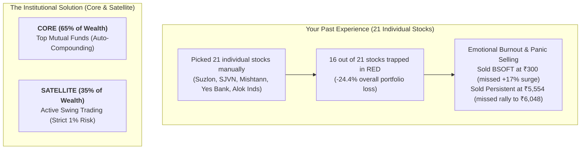
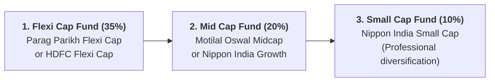
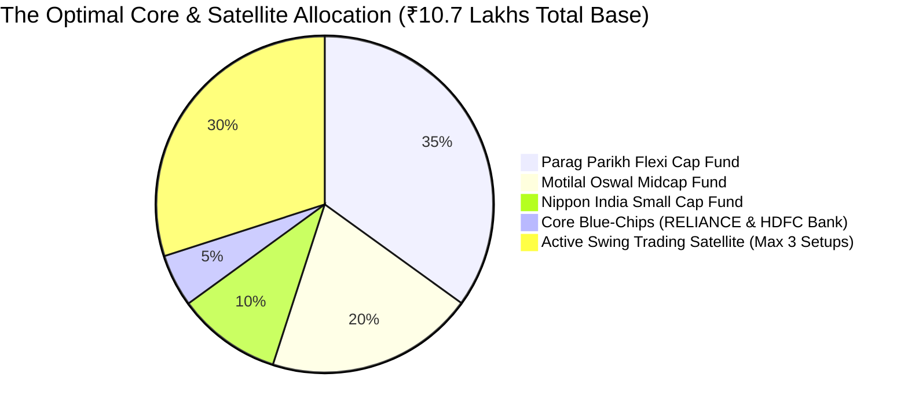

# Mutual Funds & Core-Satellite Wealth Strategy

A comprehensive guide on the best mutual funds in India and how to transition from managing a cluttered 21-stock portfolio into a stress-free **Core & Satellite Wealth Engine**.

---

## 1. Why Your Current Holdings Proved You Need Mutual Funds

Looking at your 21 holdings reveals the classic trap of retail stock-picking:

### The Difference in Stock Selection:
* **What Top Mutual Funds Hold:** Reliance, HDFC Bank, ICICI Bank, Persistent Systems, Infosys, Zomato/Eternal, Bharti Airtel.
* **What Trapped Your Capital:** Mishtann (₹2.89), Alok Industries (₹8.07), EaseMyTrip (₹5.93), Suzlon (₹33), Yes Bank (₹15).
* **The Lesson:** When you invest in a top mutual fund, an elite fund manager (with 25+ years of experience and a team of 15 equity analysts) does the research, monitors quarterly earnings, and automatically cuts losing companies while letting winners compound.

---

## 2. The Best Mutual Funds in India (By Category)

*Always select the **DIRECT - GROWTH** plan for any fund to avoid paying 1% to 1.5% in distributor commissions.*

---

### Category 1: Flexi Cap Funds (The Core Engine - 35% Allocation)
* **Role:** Can invest dynamically across large-caps, mid-caps, and small-caps. Best suited for long-term multi-year compounding.

1. **Parag Parikh Flexi Cap Fund (Direct - Growth)**
   * **Why it stands out:** The gold standard of Indian mutual funds. High focus on cash-flow generating businesses, international equity diversification (Alphabet/Google, Meta), conservative cash holding during bubbles, and low portfolio turnover.
   * **Ideal for:** Anyone who wants to sleep peacefully without worrying about market crashes.
2. **HDFC Flexi Cap Fund (Direct - Growth)**
   * **Why it stands out:** Managed by veteran fund manager Roshi Jain. Excellent contrarian value-investing strategy that has delivered alpha across multiple 5-year cycles.

---

### Category 2: Mid Cap Funds (High Growth Engine - 20% Allocation)
* **Role:** Invests in companies ranked 101 to 250 (fast-growing market challengers).

1. **Motilal Oswal Midcap Fund (Direct - Growth)**
   * **Why it stands out:** High-conviction, focused growth portfolio. Aggressively identifies mid-market leaders with expanding return on capital (ROCE > 20%).
2. **Nippon India Growth Fund (Direct - Growth)**
   * **Why it stands out:** One of the oldest mid-cap funds in India with a 25-year track record of turning mid-caps into large-caps.

---

### Category 3: Small Cap Funds (Managed Alpha - 10% Allocation)
* **Why buy a Small Cap Fund instead of Penny Stocks?**
  * When retail investors buy penny stocks (*Mishtann*, *Alok Industries*), they buy 1 or 2 speculative companies that crash -60%.
  * A professional small-cap fund manager diversifies across **70 to 100 emerging companies**. If 5 fail, the 20 winners that grow 500% overpower the losses!

1. **Nippon India Small Cap Fund (Direct - Growth)**
   * **Why it stands out:** Outstanding downside protection and broad sector diversification across capital goods, chemicals, and manufacturing.

---

## 3. The "Core & Satellite" Reallocation Blueprint (Using Your ₹10.7 Lakhs)

Your total liquid and equity wealth is **₹1,069,554.30** (~₹10.7 Lakhs). 

Here is how to allocate your capital for maximum compounding and zero emotional stress:

### Capital Allocation Table:

| Bucket | Asset / Fund Name | Target Allocation % | Amount (₹) | Execution Method |
| :--- | :--- | :---: | :---: | :--- |
| **Core (Stability)** | **Parag Parikh Flexi Cap Fund** | 35% | **₹3,74,000** | Lumpsum / 6-Month Weekly STP |
| **Core (Growth)** | **Motilal Oswal Midcap Fund** | 20% | **₹2,14,000** | 6-Month Weekly STP |
| **Core (Alpha)** | **Nippon India Small Cap Fund**| 10% | **₹1,07,000** | Monthly SIP (₹15,000/month) |
| **Core (Direct Equity)**| **RELIANCE & HDFCBANK** | 5% | **₹54,000** | Retain existing holdings |
| **Satellite (Active Swing)**| **High-Momentum Setups** | **30%** | **₹3,20,554** | Max 3 trades at a time (1% Risk) |
| **TOTAL BASE** | | **100%** | **₹10,69,554** | **Fully Optimized Wealth Engine** |

---

## 4. Immediate Step-by-Step Transition Plan

1. **Monday Morning (09:15 – 09:30 AM):**
   * Execute immediate exits on your 6 toxic holdings: `SUZLON`, `YESBANK`, `MISHTANN`, `ALOKINDS`, `EASEMYTRIP`, `KOHINOOR`, `BAJAJHFL`.
   * Book profit on `IDEA` (+42%) and `UJJIVANSFB` (+56%).
   * This immediately credits **~₹1.75 Lakhs** into your Zerodha ledger.
2. **Consolidate with Realized Cash:**
   * Adding this to your existing **₹6.10 Lakhs** realized from Persistent, Bsoft, Aptus, and IRFC brings your deployable liquid cash to **~₹7.85 Lakhs**.
3. **Deploy the Core Mutual Funds (via Coin by Zerodha):**
   * Start a Weekly Systematic Transfer / Investment into **Parag Parikh Flexi Cap** and **Motilal Oswal Midcap**.
   * Your wealth compounds automatically at 12% to 15% CAGR without you having to stare at charts every day.
4. **Deploy the Active Swing Trading Satellite (₹3.20 Lakhs):**
   * Keep ₹3.20 Lakhs in your trading account.
   * Take only **1 or 2 trades at a time** using our 20/50 EMA pullback rules on market leaders (`BHARTIARTL`, `SUNPHARMA`, `PERSISTENT` on pullback).
   * Risk strictly **₹3,200 per trade (1%)**. 
   * You will never panic-sell again because 70% of your net worth is compounding safely in institutional hands!
