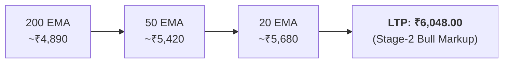
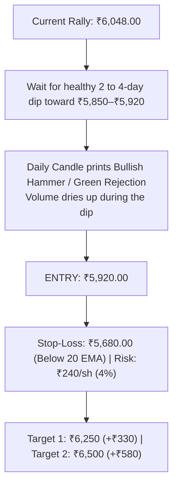
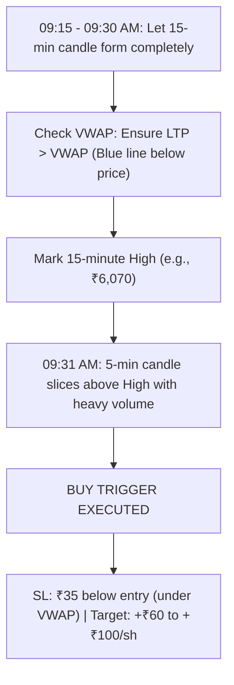

# Persistent Systems (`PERSISTENT`): Swing & Intraday Trade Blueprint

**Exchange:** NSE | **Current Market Price (CMP):** ~₹6,048.00  
**Sector:** IT - Software (Digital Engineering & AI Cloud) | **Universe:** Nifty 200, F&O Eligible

---

## 1. Fundamentals & Q2 Results Catalyst

* **Revenue Growth:** Rupee revenue surged **+30.3% YoY to ₹4,663.9 Crore** (marking its 26th consecutive quarter of sequential revenue growth).
* **Order Bookings:** Robust Total Contract Value (TCV) of **$633.5 Million**, proving resilient demand from US and European enterprise clients.
* **Profitability Context:** Reported PAT had a temporary dip due to a one-time ₹185 Crore acquisition-related expense (takeover proceedings for Germany's Nagarro). Normalized operational profit grew steadily (+5% YoY), and EBIT margins held steady at 15%.
* **Verdict:** Persistent is the undisputed leader in mid-tier IT, enjoying strong institutional sponsorship.

---

## 2. Technical Standing (Daily 1D Chart)

* **EMA Alignment:** `Price (₹6,048) > 20 EMA (₹5,680) > 50 EMA (₹5,420) > 200 EMA (₹4,890)`. Full green-light institutional alignment.
* **Price Action:** The stock recently broke out past the critical psychological barrier of **₹6,000.00**.
* **Golden Trading Rule:** **NEVER chase a stock that has run up vertically 15% without resting.** You do not buy market orders at ₹6,050. You trade either a controlled swing pullback or a morning intraday breakout.

---

## 3. Plan A: The Swing Trading Setup (Holding 2 to 4 Weeks)

### The Setup: Retest & 20 EMA Pullback
Wait for the stock to digest its recent surge and pull back toward the previous resistance-turned-support zone.

### Exact Execution Numbers:
* **Entry Zone:** **₹5,850.00 – ₹5,920.00** (on daily reversal confirmation).
* **Alternative Breakout Entry:** If the stock consolidates sideways between ₹5,980 and ₹6,065 for 3 days, enter on a decisive daily close **above ₹6,070.00** with 1.5x volume.
* **Stop-Loss:** **₹5,680.00** (placed below the 20-day EMA support shelf).
* **Risk per Share:** ₹5,920 - ₹5,680 = **₹240.00 per share**.
* **Position Sizing (₹10,000 Risk Rule):**
  $$\text{Shares to Buy} = \frac{₹10,000}{₹240} = \mathbf{41 \text{ shares}}$$
* **Total Investment Value:** $41 \times ₹5,920 = ₹2,42,720$.
* **Target 1 (1:1.5 R:R):** **₹6,250.00** (Sell 50% = 20 shares $\rightarrow$ Book **+₹6,600** profit, move Stop-Loss to Breakeven).
* **Target 2 (1:2.4 R:R):** **₹6,500.00** (Sell remaining 21 shares $\rightarrow$ Book **+₹12,180** profit).
* **Target 3 (Extension):** **₹6,800.00** (Major institutional cycle target).

---

## 4. Plan B: The High-Momentum Intraday Plan (5-Minute / 15-Minute Chart)

### Strategy: 15-Minute Opening Range Breakout (ORB) + VWAP
* **Best Window:** 09:15 AM to 10:30 AM IST.

### Exact Intraday Numbers (Example Scenario):
* **Entry Trigger:** Buy when a 5-minute candle breaks **above the 09:15–09:30 High** (AND price is above VWAP).
* **Stop-Loss:** Placed **below the VWAP line** (typically a risk of ~₹35.00 to ₹45.00 per share, which is only ~0.6%–0.7%).
* **Intraday Target 1:** +1.0% quick expansion (+₹60.00 per share).
* **Intraday Target 2:** +1.8% expansion (+₹110.00 per share).
* **Position Sizing (₹5,000 Intraday Risk):**
  $$\text{Shares to Buy} = \frac{₹5,000}{₹40 \text{ risk}} = \mathbf{125 \text{ shares}}$$
* **Non-Negotiable Intraday Rule:** All open positions MUST be squared off by **03:15 PM**. Never hold an intraday trade overnight.

---

## 5. Summary Cheat Sheet for PERSISTENT

| Strategy | When to Enter | Stop-Loss | Target 1 | Target 2 | Holding Period |
| :--- | :--- | :---: | :---: | :---: | :--- |
| **Swing Trade** | Dip to **₹5,850–₹5,920** (or close > ₹6,070) | **₹5,680.00** | **₹6,250.00** | **₹6,500.00** | 2 to 4 Weeks |
| **Intraday Trade** | 09:31 AM Break of 15-min High (LTP > VWAP) | **Below VWAP** | **+₹60/sh** | **+₹110/sh** | Same Day (Exit by 03:15 PM) |
