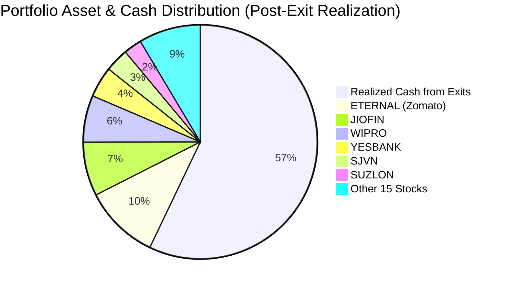
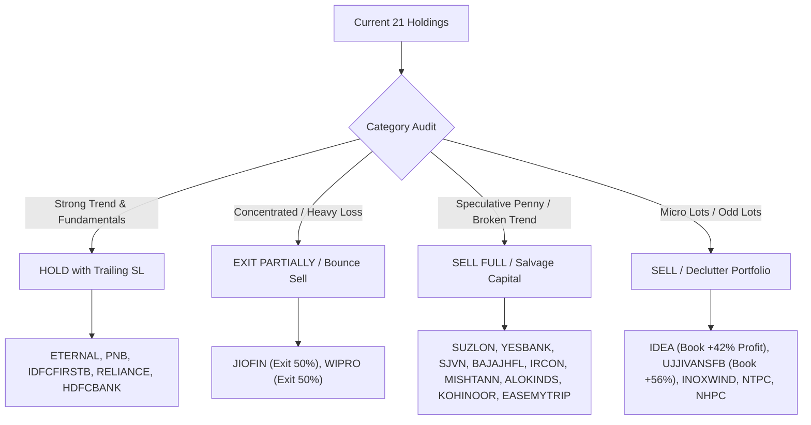
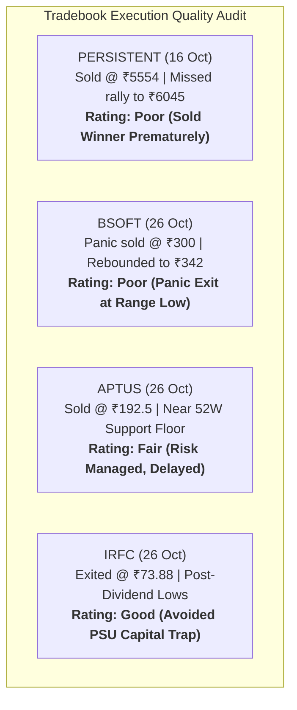
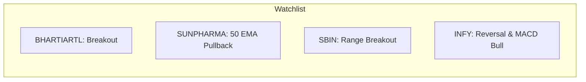
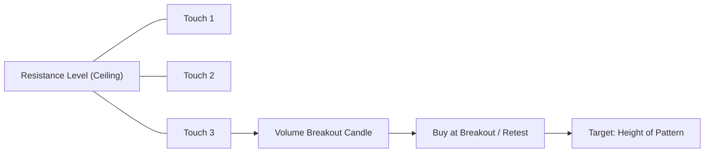
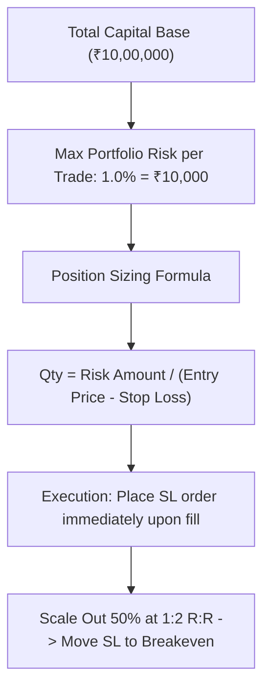
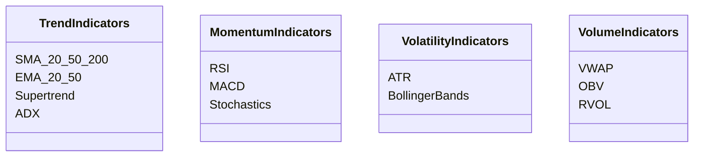
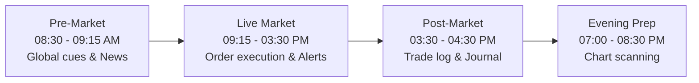
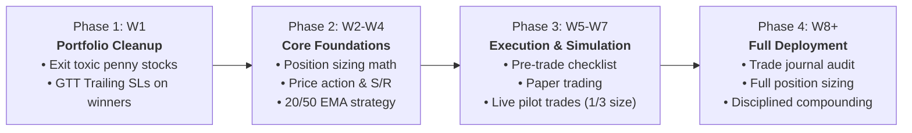

# Zerodha Portfolio Restructuring Audit & Professional Swing Trading Playbook

---

## Executive Summary & Capital Audit

This audit evaluates your **21 current equity holdings** and **recent tradebook exits** as of late October 2026. 

### Capital Overview

| Metric | Amount (₹) | % of Portfolio / Benchmark |
| :--- | :--- | :--- |
| **Total Invested Capital (Current Holdings)** | ₹6,07,075.99 | 100.00% |
| **Current Market Value (Holdings)** | ₹458,827.15 | 75.58% |
| **Net Unrealized Portfolio P&L** | **-₹148,248.84** | **-24.42%** |
| **Profitable Positions (5 Stocks)** | +₹36,372.90 | 5 of 21 stocks |
| **Losing Positions (16 Stocks)** | **-₹184,621.74** | 16 of 21 stocks |
| **Realized Liquid Cash (Recent Exits)** | **₹610,727.15** | Persistent, Bsoft, Aptus, IRFC |
| **Total Portfolio Net Worth (Equity + Cash)** | **₹1,069,554.30** | Total Trading & Investment Base |

> [!IMPORTANT]
> **The Key Psychological Trap Uncovered:**
> Your tradebook and holdings reflect the classic **Disposition Effect**—the psychological tendency to sell profitable, high-quality winners prematurely (e.g., selling *Persistent Systems* at ₹5,554 before it rallied to ₹6,045+), while holding onto deeply deteriorating, speculative losers (*SJVN* -53%, *Suzlon* -51%, *Inox Wind* -73%, *Mishtann* -59%, *Alok Industries* -68%) hoping they will return to your cost price.
>
> Reversing this single habit—**cutting losers decisively at a predefined stop-loss and letting winners ride with a trailing stop-loss**—will transform your trading trajectory.

---

## 1. Portfolio Analysis: Stock-by-Stock Action Plan

Every holding is categorized based on earnings trajectory, relative technical strength vs. the Nifty 50 (trading at 23,053), sector tailwinds, and capital efficiency.

### Complete Holdings Matrix

| Instrument | Qty | Avg Cost (₹) | LTP (₹) | Current Val (₹) | P&L (₹) | P&L (%) | Portfolio Weight | Action Recommendation | Stop-Loss / Trailing SL (₹) | Target 1 / Target 2 (₹) |
| :--- | :--- | :--- | :--- | :--- | :--- | :--- | :--- | :--- | :--- | :--- |
| **ETERNAL** | 325 | 254.47 | 342.50 | 1,11,312.50 | +28,610.00 | +34.59% | 24.26% | **HOLD** (Trailing SL) | TSL: ₹320.00 | T1: ₹365 / T2: ₹390 |
| **JIOFIN** | 390 | 267.82 | 204.68 | 79,825.20 | -24,622.95 | -23.57% | 17.40% | **EXIT PARTIALLY (50%)** | Hard SL: ₹195.00 | Rebound: ₹220 / ₹235 |
| **WIPRO** | 350 | 271.77 | 197.31 | 69,058.50 | -26,059.95 | -27.40% | 15.05% | **EXIT PARTIALLY (50%)** | Hard SL: ₹188.00 | Rebound: ₹215 / ₹228 |
| **YESBANK** | 3,000 | 20.76 | 15.17 | 45,510.00 | -16,760.00 | -26.92% | 9.92% | **SELL / FULL EXIT** | Immediate Exit | Opportunity Reallocation |
| **SJVN** | 650 | 114.98 | 53.63 | 34,859.50 | -39,875.00 | -53.36% | 7.60% | **SELL ON BOUNCE** | Stop: ₹50.00 | Bounce Exit: ₹58 – ₹62 |
| **SUZLON** | 800 | 67.49 | 33.35 | 26,680.00 | -27,311.00 | -50.58% | 5.81% | **SELL / FULL EXIT** | Immediate Exit | Capital Salvage |
| **IDEA** | 1,200 | 8.28 | 11.77 | 14,124.00 | +4,190.00 | +42.18% | 3.08% | **BOOK PROFIT / EXIT** | Lock in ₹11.50 | Realize +42% Gain |
| **BAJAJHFL** | 180 | 138.51 | 77.33 | 13,919.40 | -11,012.20 | -44.17% | 3.03% | **SELL / FULL EXIT** | Stop: ₹74.00 | Rebound: ₹84.00 |
| **PNB** | 100 | 103.19 | 122.45 | 12,245.00 | +1,926.00 | +18.66% | 2.67% | **HOLD** (Trailing SL) | TSL: ₹115.00 | T1: ₹135 / T2: ₹145 |
| **RELIANCE** | 10 | 1,364.00 | 1,159.50 | 11,595.00 | -2,045.00 | -14.99% | 2.53% | **HOLD** | SL: ₹1,110.00 | T1: ₹1,260 / T2: ₹1,340 |
| **IRCON** | 100 | 220.59 | 96.65 | 9,665.00 | -12,394.00 | -56.19% | 2.11% | **SELL ON BOUNCE** | Stop: ₹92.00 | Bounce Exit: ₹105 – ₹110 |
| **IDFCFIRSTB** | 110 | 58.68 | 71.92 | 7,911.20 | +1,456.60 | +22.57% | 1.72% | **HOLD** (Trailing SL) | TSL: ₹67.00 | T1: ₹78 / T2: ₹84 |
| **MISHTANN** | 2,000 | 7.04 | 2.89 | 5,780.00 | -8,296.18 | -58.94% | 1.26% | **SELL / COMPLETE EXIT**| Market Order | Salvage ₹5,780 |
| **EASEMYTRIP**| 850 | 15.96 | 5.93 | 5,040.50 | -8,527.00 | -62.85% | 1.10% | **SELL / COMPLETE EXIT**| Market Order | Salvage ₹5,040 |
| **NHPC** | 50 | 82.14 | 77.57 | 3,878.50 | -228.50 | -5.56% | 0.85% | **SELL / DECLUTTER** | Stop: ₹74.00 | Exit to Declutter |
| **HDFCBANK** | 4 | 866.50 | 690.50 | 2,762.00 | -704.00 | -20.31% | 0.60% | **HOLD / ACCUMULATE** | SL: ₹645.00 | T1: ₹760 / T2: ₹820 |
| **ALOKINDS** | 250 | 24.89 | 8.07 | 2,017.50 | -4,205.00 | -67.58% | 0.44% | **SELL / COMPLETE EXIT**| Market Order | Salvage ₹2,017 |
| **KOHINOOR** | 50 | 43.89 | 24.87 | 1,243.50 | -951.16 | -43.34% | 0.27% | **SELL / COMPLETE EXIT**| Market Order | Salvage ₹1,243 |
| **INOXWIND** | 10 | 208.56 | 55.41 | 554.10 | -1,531.50 | -73.43% | 0.12% | **SELL / COMPLETE EXIT**| Market Order | Micro-lot Clean up |
| **UJJIVANSFB**| 10 | 33.99 | 53.02 | 530.20 | +190.30 | +55.99% | 0.12% | **BOOK PROFIT / EXIT** | Market Order | Realize Gain |
| **NTPC** | 1 | 413.85 | 315.55 | 315.55 | -98.30 | -23.75% | 0.07% | **SELL / DECLUTTER** | Market Order | 1-share Odd lot Clean up|

---

### Detailed Rationale for Every Holding

#### 1. ETERNAL (Eternal Ltd / Zomato) — HOLD (Trailing SL)
* **Fundamentals & Earnings:** Exceptional operational turnaround. Quick commerce (*Blinkit*) is demonstrating operating leverage, expanding GOV (Gross Order Value) and margin contribution, while food delivery remains a steady cash cow.
* **Technical Structure:** Trading right near its 52-week high of ₹346. Sustaining comfortably above the 20-day EMA (₹326) and 50-day EMA (₹308). RSI is 64 (healthy momentum, not overbought).
* **Action:** Do not sell impulsively. Set a **Trailing Stop-Loss at ₹320.00** (below the 20-day EMA). Target ₹365 and ₹390.

#### 2. JIOFIN (Jio Financial Services) — EXIT 50% ON PULLBACK
* **Fundamentals & Earnings:** Massive balance sheet strength and backing by Reliance, but actual credit lending monetization and Jio-BlackRock JV revenue streams remain slow-ramping. Return on Equity (RoE) is negligible (~1.5–2%).
* **Technical Structure:** Position constitutes 17.4% of your portfolio value and is down -23.57%. Broke below the 200-day EMA with a sequence of lower highs and lower lows.
* **Action:** Reduce your exposure by 50% (sell 195 shares) on any rebound toward ₹218–₹225. Lock an absolute risk-stop at ₹195. Reallocate into active market leaders.

#### 3. WIPRO — EXIT 50% ON PULLBACK
* **Fundamentals & Earnings:** Subdued organic revenue growth compared to Tier-1 peers (Infosys, TCS, HCLTech). Large consulting exposure (*Capco*) faces discretionary tech spending pauses.
* **Technical Structure:** Lagging behind the Nifty IT index. While Nifty IT gained +2.32% late October, Wipro is trapped below its downward-sloping 50-day EMA (₹212).
* **Action:** Trim 50% (sell 175 shares) on any dead-cat rally toward ₹210–₹215. Reinvest capital into leading IT momentum stocks like Persistent or Infosys.

#### 4. YESBANK — SELL / COMPLETE EXIT
* **Fundamentals & Earnings:** Return on Assets (RoA) hovers around ~0.5–0.6%. Enormous equity base (over 3,100 crore shares), massive retail overhang, and sluggish loan book expansion.
* **Technical Structure:** Chronic underperformer. Stuck in a dead band between ₹14 and ₹17 below both the 50 and 200 EMA. 
* **Action:** Immediate exit. Holding ₹45,510 in a zombie stock blocks capital that can generate active swing gains.

#### 5. SJVN — SELL ON BOUNCE (Q2 Numbers Reaction)
* **Fundamentals & Earnings:** Reported Q2 FY27 standalone profit jump of 98% YoY to ₹736 Cr on Oct 30, but this was heavily driven by prior-period retrospective tariff orders (₹242.6 Cr one-time gain). High capital expenditure and execution delays persist.
* **Technical Structure:** Down -53.36%. Broken intermediate uptrend, trading well beneath 200 EMA (₹78). 
* **Action:** Use the Q2 earnings-driven reaction bounce (expected towards ₹58–₹62) to exit completely. Never hold hoping for ₹115.

#### 6. SUZLON — SELL / COMPLETE EXIT
* **Fundamentals & Earnings:** Plunged -9.35% today (Oct 30) after Q2 FY27 results revealed EBITDA margin compression from 18.6% to 14.7%, and management lowered full-year margin guidance to ~15%.
* **Technical Structure:** Hit a fresh 52-week low of ₹33.21 on heavy distribution volume. The stock has violated all technical supports.
* **Action:** Immediate exit. Holding a stock that breaks 52-week lows on institutional downgrade volume violates core capital preservation. Salvage the remaining ₹26,680.

#### 7. IDEA (Vodafone Idea) — BOOK PROFIT / COMPLETE EXIT
* **Fundamentals & Earnings:** Severe ongoing subscriber churn, huge government equity dilution risk, and heavy AGR debt liability.
* **Technical Structure:** Sitting on +42.18% profit at ₹11.77 from an entry of ₹8.28. Price action shows stiff resistance at ₹12.50–₹13.00.
* **Action:** Book the profit! Taking a +42% profit on a distressed penny stock is a major tactical victory. Do not let it turn into a loss.

#### 8. BAJAJHFL (Bajaj Housing Finance) — SELL / FULL EXIT
* **Fundamentals & Earnings:** IPO listing euphoria inflated valuation to >7x Price-to-Book. Margin pressures in prime housing loans and institutional anchor lock-in expiry have triggered structural derating.
* **Technical Structure:** Continuous descent from ₹180+ to ₹77.33 (-44.17%). No base formation visible yet.
* **Action:** Sell and salvage ₹13,919. Reallocate to established compounders like HDFC Bank or ICICI Bank.

#### 9. PNB (Punjab National Bank) — HOLD (Trailing SL)
* **Fundamentals & Earnings:** PSU banking tailwinds. Gross NPAs declining steadily, credit growth robust at 13–15%, and RoA stabilizing near 0.8–0.9%.
* **Technical Structure:** Uptrend intact (+18.66% profit). Trades above its 50 EMA (₹114).
* **Action:** Hold with a **Trailing SL at ₹115.00**. Targets: T1 ₹135, T2 ₹145.

#### 10. RELIANCE — HOLD (Core Portfolio Asset)
* **Fundamentals & Earnings:** India's largest corporate powerhouse. Refining margins stabilizing, retail retail expanding, and Jio telecom tariff hike monetizing.
* **Technical Structure:** Post-bonus adjustment, RIL trades at ₹1,159.50, holding the critical ₹1,120 support floor.
* **Action:** Hold. Downside is well protected. Upside targets ₹1,260 and ₹1,340.

#### 11. IRCON — SELL ON BOUNCE
* **Fundamentals & Earnings:** Won ₹862 Cr EPC contract from East Central Railway in October; Q2 FY27 results scheduled for Nov 4. However, railway capex growth rate is normalizing.
* **Technical Structure:** Down -56.19%. Trapped in a stage-4 markdown phase below the 200 EMA (₹145).
* **Action:** Place a sell order around the earnings bounce zone of ₹105–₹110.

#### 12. IDFCFIRSTB — HOLD (Trailing SL)
* **Fundamentals & Earnings:** High CASA ratio (~47%), strong retail asset franchise, and consistent operating performance.
* **Technical Structure:** Profitable at +22.57%. Consolidating constructively above its 50 EMA (₹68).
* **Action:** Hold with **Trailing SL at ₹67.00**. Target ₹78 and ₹84.

#### 13–21. Microcap & Clutter Stocks — COMPLETE EXIT
* **MISHTANN (LTP ₹2.89, -58.9%)**: Sell immediately. Microcap governance concerns, severe illiquidity. Salvage ₹5,780.
* **EASEMYTRIP (LTP ₹5.93, -62.8%)**: Sell immediately. Massive promoter dilution and constant downward drift. Salvage ₹5,040.
* **ALOKINDS (LTP ₹8.07, -67.6%)**: Sell immediately. Chronic losses, speculative pump-and-dump behavior. Salvage ₹2,017.
* **KOHINOOR (LTP ₹24.87, -43.3%)**: Sell immediately. Structurally weak financials. Salvage ₹1,243.
* **NHPC (LTP ₹77.57, -5.5%)**: Sell to declutter. Holding 50 shares (₹3,878) adds negligible portfolio impact.
* **HDFCBANK (LTP ₹690.50, -20.3%)**: Hold or accumulate. Premier private lender; 4 shares (₹2,762) is an odd-lot that should either be built up or kept as a long-term compounder.
* **INOXWIND (LTP ₹55.41, -73.4%)**: Sell immediately. 10 shares worth ₹554 is clutter.
* **UJJIVANSFB (LTP ₹53.02, +55.9%)**: Book profit. 10 shares worth ₹530. Realize gain.
* **NTPC (LTP ₹315.55, -23.7%)**: Sell 1 share odd lot (₹315).

---

## 2. Tradebook Audit: Critique of Recent Exits

Your tradebook records 4 closed positions between October 16 and October 26, 2026:

### 1. PERSISTENT (Sold 60 shares @ ₹5,554 on 2026-10-16 | Cash Realized: ₹3,33,240.00)
* **What Happened:** Persistent Systems subsequently rallied from ₹5,554 to **₹6,045.00** by October 30 (+8.8% upside missed, worth **₹29,460.00** in lost profit).
* **Critique:** **Premature Exit of a Sector Leader.** Persistent was exhibiting strong relative strength in an outperforming IT sector. You sold at a fixed price rather than using a **20-day EMA trailing stop-loss**.
* **Mentor Takeaway:** Never exit a runaway winning stock just because it feels "high." Ride the trend using a dynamic trailing stop.

### 2. BSOFT (Sold 635 shares @ ₹300 on 2026-10-26 | Cash Realized: ₹1,90,500.00)
* **What Happened:** Birlasoft bounced sharply from the ₹290–₹300 support floor to trade near **₹342.50** by late October (+14.1% rebound missed, worth **₹26,987.50**).
* **Critique:** **Panic Exit at Range Bottom.** You sold at 09:24 AM right into heavy morning capitulation at major multi-month support.
* **Mentor Takeaway:** Never sell out of panic at the absolute support line. Either exit early when the breakdown trigger confirms, or wait for the dead-cat bounce to the 20 EMA.

### 3. APTUS (Sold 260 shares @ ₹192.49 on 2026-10-26 | Cash Realized: ₹50,047.15)
* **What Happened:** Traded between ₹192 and ₹199 through late October.
* **Critique:** **Acceptable Risk Cut, but Delayed.** You held through the entire down-move from ₹230 to ₹192 before exiting at the 52-week low.
* **Mentor Takeaway:** The initial stop-loss should have been placed around ₹218. Cutting a trade at -18% that was intended as a swing is a breakdown in trade discipline.

### 4. IRFC (Sold 500 shares @ ₹73.88 on 2026-10-26 | Cash Realized: ₹36,940.00)
* **What Happened:** Stock consolidated around ₹73–₹75 post the interim dividend record date (Oct 23).
* **Critique:** **Good Strategic Exit.** Even though the exit was delayed from higher levels, getting out of a decelerating railway PSU with zero swing momentum frees up capital for high-probability setups.

---

## 3. High-Probability Swing Trading Setups (NSE Stocks)

These setups represent market leaders showing institutional accumulation, relative strength vs. Nifty, and clean price-action structures.

### Trade Plan 1: BHARTI AIRTEL (`BHARTIARTL`) — Trend Continuation & Breakout
* **Sector / Theme:** Telecom Leader (Strong ARPU expansion & data monetization).
* **Technical Setup:** Consolidating in a tight high-level base near ₹1,950–₹1,970 after a strong rally from ₹1,740. 20-day EMA is sloping upward at ₹1,890. Daily RSI is at 62 (strong momentum without exhaustion).
* **Action Plan:**
  * **Entry Zone:** ₹1,965.00 – ₹1,975.00 (on 15-min candle close above previous day high).
  * **Stop-Loss:** **₹1,895.00** (below 20-day EMA and breakout base support). Risk per share = ₹75.00 (3.8%).
  * **Target 1:** **₹2,100.00** (Reward: ₹130 / R:R = 1:1.73).
  * **Target 2:** **₹2,220.00** (Reward: ₹250 / R:R = 1:3.33).
  * **Holding Period:** 2 to 4 weeks.
  * **Position Sizing (₹10,000 Risk):** 133 shares (~₹2,62,000 allocated).

### Trade Plan 2: SUN PHARMA (`SUNPHARMA`) — 50-day EMA Pullback & Reversal
* **Sector / Theme:** Pharmaceuticals (Defensive growth & US specialty pipeline expansion).
* **Technical Setup:** Healthy pullback from ₹2,045 to test its rising 50-day EMA support at ₹1,750–₹1,780. Daily candlestick printed a bullish hammer at the support shelf. RSI bounced from 44 back above 50.
* **Action Plan:**
  * **Entry Zone:** ₹1,785.00 – ₹1,795.00.
  * **Stop-Loss:** **₹1,720.00** (below recent swing low and 50 EMA). Risk per share = ₹70.00 (3.9%).
  * **Target 1:** **₹1,920.00** (Reward: ₹130 / R:R = 1:1.85).
  * **Target 2:** **₹2,040.00** (Reward: ₹250 / R:R = 1:3.57).
  * **Holding Period:** 2 to 3 weeks.
  * **Position Sizing (₹10,000 Risk):** 142 shares (~₹2,54,000 allocated).

### Trade Plan 3: STATE BANK OF INDIA (`SBIN`) — Range Consolidation Breakout
* **Sector / Theme:** Large-Cap PSU Banking Leader (Strong asset quality, RoA > 1%).
* **Technical Setup:** Tight 4-week consolidation between ₹940 and ₹980. The 20 EMA and 50 EMA are converging positively. A decisive daily close above ₹982 triggers a stage-2 continuation breakout.
* **Action Plan:**
  * **Entry Zone:** ₹984.00 – ₹988.00 (on confirmed daily close above ₹982).
  * **Stop-Loss:** **₹942.00** (below range floor and 50 EMA). Risk per share = ₹44.00 (4.5%).
  * **Target 1:** **₹1,050.00** (Reward: ₹64 / R:R = 1:1.45).
  * **Target 2:** **₹1,120.00** (Reward: ₹134 / R:R = 1:3.05).
  * **Holding Period:** 3 to 5 weeks.
  * **Position Sizing (₹10,000 Risk):** 227 shares (~₹2,24,000 allocated).

### Trade Plan 4: INFOSYS (`INFY`) — Sector Rotation & MACD Bullish Crossover
* **Sector / Theme:** Tier-1 IT (Beneficiary of sector leadership rotation in late October).
* **Technical Setup:** IT index gained +2.32% led by persistent demand. Infosys has formed an inverted Head & Shoulders base around ₹1,120–₹1,140. MACD line is crossing above signal line below zero.
* **Action Plan:**
  * **Entry Zone:** ₹1,170.00 – ₹1,180.00.
  * **Stop-Loss:** **₹1,125.00** (below the right shoulder swing low). Risk per share = ₹50.00 (4.2%).
  * **Target 1:** **₹1,265.00** (Reward: ₹90 / R:R = 1:1.80).
  * **Target 2:** **₹1,340.00** (Reward: ₹165 / R:R = 1:3.30).
  * **Holding Period:** 2 to 4 weeks.
  * **Position Sizing (₹10,000 Risk):** 200 shares (~₹2,35,000 allocated).

---

## 4. Practical Swing Trading Strategies

### 1. Breakout Trading
* **Concept:** Entering a stock as its price pierces above an established resistance level with expanding volume.
* **Key Patterns:** Flat-top resistance breakout, Ascending Triangle, Bull Flag, Cup & Handle.
* **Rule of Execution:** Never buy an unconfirmed intraday spike. Wait for the 15-minute or daily candle to close above the resistance line. Confirm that breakout volume is **at least 1.5x–2x the 20-day average volume**.

### 2. EMA Pullback Trading
* **Concept:** In a strong trending stock, price routinely pulls back toward its dynamic moving averages (20 EMA in fast trends, 50 EMA in intermediate trends).
* **Trigger:** Stock in established uptrend (Price > 20 EMA > 50 EMA > 200 EMA) touches the 20 EMA or 50 EMA and prints a reversal candle (Bullish Hammer, Bullish Engulfing, or Morning Star).
* **Stop-Loss:** Placed 0.5% below the low of the pullback candle.

### 3. RSI Reversal & Divergence
* **Concept:** Identifies momentum exhaustion before price reverses.
  * **Regular Bullish Divergence:** Price makes a **Lower Low**, but the RSI makes a **Higher Low**. Indicates selling momentum is dying; institutional accumulation is occurring.
  * **Execution:** Wait for the trigger candle to break the high of the divergence candle. Enter with stop-loss below the recent price swing low.

### 4. MACD Zero-Line & Signal Crossover
* **Concept:** The Moving Average Convergence Divergence measures trend direction and rate of change.
  * **Best Swing Setup:** Look for a bullish MACD crossover (MACD line crosses above the Signal line) while the histogram flips from negative to positive. Crossovers occurring near or just above the **Zero line** in an existing daily uptrend offer the highest success rate.

### 5. Supertrend Trend-Following
* **Parameters:** Period: 10, Multiplier: 3 (Standard).
* **Application in Swing Trading:**
  * Never buy when the Supertrend is Red (Sell mode).
  * Enter when a stock with strong fundamentals triggers a Green Supertrend flip on the Daily chart with volume.
  * Use the Supertrend line as a dynamic trailing stop-loss.

### 6. Support and Resistance Polarity Principle
* **Concept:** "Former Resistance becomes New Support."
* **Execution:** Once a stock breaks out above a major resistance (e.g., a 6-month high at ₹500), it often retraces back to ₹500. When ₹500 holds as support and prints a green rejection candle, enter long. This minimizes risk because your stop-loss is placed just below the support shelf.

### 7. Volume Breakout (High Relative Volume - RVOL)
* **Concept:** Price moves driven by retail traders lack follow-through; institutional moves are stamped by heavy volume.
* **Criteria:** A breakout candle must have Relative Volume (RVOL) $\ge 2.0$. If the daily average volume is 10 lakh shares, the breakout day must trade $\ge 20$ lakh shares.

---

## 5. Golden Rules of Trading & Risk Management

### Rule 1: The 1% - 2% Risk Rule
Never risk more than **1% to 1.5% of your total trading capital on any single trade**.
$$\text{Max Capital at Risk per Trade} = \text{Total Capital} \times 0.01$$
* For a ₹10,00,000 portfolio, your maximum risk per trade is **₹10,000**.
* If a trade goes wrong and hits your stop-loss, you lose exactly ₹10,000 (1%), preserving 99% of your capital to trade another day.

### Rule 2: Mathematical Position Sizing Formula
Never decide your share quantity arbitrarily. Use the formula:
$$\text{Position Size (Quantity)} = \frac{\text{Maximum Risk (₹)}}{\text{Entry Price (₹)} - \text{Stop-Loss Price (₹)}}$$

**Real Example:**
* Total Capital = ₹10,00,000
* Risk per trade (1%) = ₹10,000
* Stock: Sun Pharma
* Entry: ₹1,790.00
* Stop-Loss: ₹1,720.00
* Risk per share = ₹1,790 - ₹1,720 = **₹70.00**
$$\text{Shares to Buy} = \frac{₹10,000}{₹70} = 142 \text{ shares}$$
* Total Capital Invested = $142 \times ₹1,790 = ₹2,54,180$.
* If the stock drops to ₹1,720, your loss is exactly $142 \times ₹70 = ₹9,940$ (under your ₹10,000 limit).

### Rule 3: Stop-Loss Calculation Using ATR (Average True Range)
Avoid placing stop-losses at arbitrary round numbers where market makers trigger stops. Use ATR to account for market noise.
$$\text{Stop-Loss Price} = \text{Entry Price} - (1.5 \times \text{ATR}(14))$$
* If a stock trades at ₹500 with a daily 14-period ATR of ₹12:
  $$\text{Stop Buffer} = 1.5 \times 12 = ₹18$$
  $$\text{Stop-Loss} = ₹500 - ₹18 = ₹482.00$$

### Rule 4: Trailing Stop-Loss Mechanics
A trailing stop-loss locks in accrued gains as the stock advances:
1. **Initial State:** Buy at ₹100, Stop-Loss at ₹92 (Risk = ₹8). Target 1 = ₹116 (1:2 R:R).
2. **Phase 1 (Stock reaches ₹116):** Sell 50% of your position. Lock in profit. Move the Stop-Loss on the remaining 50% to **Cost Price (₹100)**. The trade is now 100% risk-free.
3. **Phase 2 (Stock trends higher):** Trail the stop-loss below the **previous week's low** or the **rising 20-day EMA**. Only exit when the trend definitively breaks.

### Rule 5: Why You Must NEVER Average Down a Losing Trade
* **The Fallacy:** "I bought at ₹100, now it's ₹70, so it's cheaper. Let me buy more to bring my average to ₹85."
* **The Reality:** A stock drops from ₹100 to ₹70 because large institutions are distributing. By adding money to a loser (like *SJVN*, *Suzlon*, or *Yes Bank*), you increase your capital allocation to your worst-performing ideas while starving your winners of capital.
* **Golden Rule:** **Only add to winning positions that are moving in your favor (Pyramiding). Never put good money after bad.**

### Rule 6: Risk/Reward Ratio & Expectancy
In swing trading, you do not need an 80% win rate to build wealth. With a **1:2 Risk/Reward ratio**, even a **40% win rate** produces steady portfolio growth:
* 10 Trades: 4 Winners (+$20,000 each = +$80,000), 6 Losers (-$10,000 each = -$60,000).
* **Net Profit = +$20,000.**

---

## 6. Technical Indicators: Complete Learning Guide

### 1. Relative Strength Index (RSI)
* **What it is:** A momentum oscillator that measures the velocity and magnitude of price changes on a scale of 0 to 100.
* **Interpretation:**
  * **Bullish Zone (55 – 70):** Strong upward momentum. In bull trends, pullbacks to 50–55 represent buying opportunities.
  * **Bearish Zone (30 – 45):** Downward momentum dominating.
  * **Overbought (>70) & Oversold (<30):** Signal potential exhaustion, not an automatic buy/sell trigger.
* **Real Stock Example:** In *Eternal (Zomato)*, RSI sustained between 55 and 70 during its rally from ₹250 to ₹342, confirming institutional momentum.

### 2. Average True Range (ATR)
* **What it is:** A non-directional volatility indicator measuring the average trading range (High minus Low, accounting for gaps) over $N$ periods (default 14).
* **Interpretation:** High ATR = high volatility (requires wider stop-loss and smaller position size). Low ATR = low volatility (tight base formation).
* **Trading Use:** Setting dynamic stop-losses ($\text{Entry} - 1.5 \times \text{ATR}$).

### 3. Simple Moving Averages (SMA 20 / 50 / 200)
* **What it is:** The arithmetic average of closing prices over a specified window.
* **Interpretation:**
  * **200 SMA:** The definitive institutional trend divider. Price above 200 SMA = Bull market; Price below 200 SMA = Bear market.
  * **Golden Cross:** 50 SMA crosses above 200 SMA (long-term buy signal).
  * **Death Cross:** 50 SMA crosses below 200 SMA (long-term exit signal).
* **Real Stock Example:** *Suzlon* breaking below its 200 SMA at ₹58 was the clear technical signal to exit before it tumbled to ₹33.

### 4. Exponential Moving Averages (EMA 20 / 50)
* **What it is:** A weighted moving average giving greater importance to recent price data, making it more responsive than SMA.
* **Interpretation:** 
  * In a healthy swing rally, price rides above the **20 EMA**. A pullback to the 20 EMA is the primary entry zone.
  * A close below the **50 EMA** signals trend breakdown and necessitates profit booking.

### 5. Moving Average Convergence Divergence (MACD)
* **What it is:** Trend-following momentum indicator showing the relationship between two EMAs (typically 12 EMA and 26 EMA) and a 9-period signal line.
* **Trading Setup:** Buy when the MACD line crosses above the signal line from below, accompanied by green histogram bars expanding above zero.

### 6. Average Directional Index (ADX)
* **What it is:** Measures the **strength of a trend** regardless of direction (0 to 100).
* **Interpretation:**
  * **ADX < 20:** Range-bound, sideways choppy market. Avoid breakout trading.
  * **ADX > 25:** Strong trending market. Trend-following and breakout setups work reliably.
  * **ADX > 40:** Powerful runaway trend.

### 7. Supertrend (10, 3)
* **What it is:** An overlay indicator combining price and ATR to plot dynamic trailing support/resistance bands.
* **Trading Setup:** Use on the Daily chart. When green, stay long. Shift trailing stop to the Supertrend line value each trading session.

### 8. Bollinger Bands (20, 2)
* **What it is:** Consists of a middle band (20 SMA) and two outer bands set at $\pm 2$ standard deviations.
* **Trading Setup (The Squeeze):** When the bands contract tightly (low volatility squeeze), a massive directional expansion is imminent. Buy the breakout when price closes outside the upper band with expanding volume.

### 9. Volume Weighted Average Price (VWAP)
* **What it is:** The average price a stock has traded at throughout the day, based on both volume and price.
* **Trading Setup:** Used primarily for intraday entry timing. Never buy a swing entry if the stock is trading below its daily VWAP; it indicates intraday sellers are in control.

### 10. On-Balance Volume (OBV)
* **What it is:** A cumulative volume metric that adds volume on up days and subtracts volume on down days.
* **Interpretation:** If price is moving sideways but OBV is making higher highs, "smart money" is accumulating shares prior to a visible breakout.

### 11. Relative Volume (RVOL)
* **What it is:** Ratio of current volume to average volume for the same time window.
$$\text{RVOL} = \frac{\text{Current Volume}}{\text{20-day Average Volume}}$$
* **Threshold:** RVOL $\ge 2.0$ confirms institutional participation.

---

## 7. Mandatory 14-Point Pre-Trade Checklist

Before executing any buy order, confirm that the setup satisfies all 14 criteria:

| # | Check Item | Parameter / Condition | Status |
| :--- | :--- | :--- | :---: |
| **1** | **Company Fundamentals** | Profitable, positive operating cash flow, low debt, clean governance | [ ] |
| **2** | **Latest News / Announcements** | No negative regulatory notices, promoter pledgings, or tax raids | [ ] |
| **3** | **Quarterly Results Status** | Not entering 3 days prior to an earnings release (avoids event risk) | [ ] |
| **4** | **Sector Relative Strength** | Sector index is outperforming the Nifty 50 | [ ] |
| **5** | **Nifty Market Trend** | Nifty 50 trading above its 20-day EMA or holding key support | [ ] |
| **6** | **Weekly Chart Alignment** | Weekly trend is bullish or bottoming (no Stage-4 markdown) | [ ] |
| **7** | **Daily Chart Pattern** | Clean identifiable structure (Breakout, Bull Flag, 20 EMA Pullback) | [ ] |
| **8** | **RSI Check (Daily)** | RSI between 50 and 65 (momentum confirmed, not exhausted >75) | [ ] |
| **9** | **MACD Confirmation** | MACD line above signal line or histogram ticking up | [ ] |
| **10** | **EMA / SMA Alignment** | Price > 20 EMA > 50 EMA > 200 EMA | [ ] |
| **11** | **Volume Confirmation** | Breakout candle volume $\ge 1.5\times$ the 20-day average volume | [ ] |
| **12** | **Support & Resistance** | Clear horizontal floor below entry to anchor stop-loss | [ ] |
| **13** | **Defined Stop-Loss & Target** | Hard stop-loss based on ATR / structure; Target gives $\ge 1:2$ R:R | [ ] |
| **14** | **Position Size Calculated** | Max loss on trade strictly $\le 1.0\%$ of total capital base | [ ] |

---

## 8. Daily Trading Routine & 8-Week Trader Roadmap

### Daily Operational Routine

* **08:30 AM – 09:15 AM (Pre-Market Preparation):**
  * Check GIFT Nifty, US markets close (S&P 500, Nasdaq), crude oil, and US 10-year yields.
  * Read NSE/BSE corporate announcements for portfolio holdings.
  * Confirm open GTT (Good-Till-Triggered) stop-loss orders in Zerodha.
* **09:15 AM – 10:00 AM (Opening Session):**
  * Do not enter new swing trades in the first 15 minutes (avoid opening volatility and trap wicks).
  * Check if any existing position has hit target 1 or stop-loss.
* **10:00 AM – 02:30 PM (Monitoring Window):**
  * Step away from the screen. Swing trading does not require minute-by-minute watching. Let price alerts do the work.
* **02:30 PM – 03:20 PM (Execution Window):**
  * Evaluate candidate breakout stocks. If a daily candle is closing strong above resistance with heavy volume, execute the planned entry.
* **03:30 PM – 04:30 PM (Journaling):**
  * Log every executed trade, entry price, stop-loss, and technical reason into your trading journal.
* **07:00 PM – 08:30 PM (Evening Scanning):**
  * Scan Nifty 500 stocks for 20 EMA pullbacks, 52-week high consolidations, and volume spikes. Update tomorrow's watchlist.

---

### Structured 8-Week Learning Roadmap

| Phase | Timeline | Core Focus | Measurable Milestone |
| :--- | :--- | :--- | :--- |
| **Phase 1: Cleanup & Shielding** | **Week 1** | Portfolio Restructuring | Salvage ₹2.35L from losers; place GTT trailing stops on ETERNAL, PNB, IDFCFIRSTB. |
| **Phase 2: Technical Foundations** | **Weeks 2 – 4** | Risk Math & Price Action | Calculate position size for 1% risk; master S&R polarity, 20 EMA pullbacks, and volume confirmation. |
| **Phase 3: Execution & Pilot** | **Weeks 5 – 7** | Checklist & Controlled Pilot | Filter setups with the 14-point checklist; take 5 simulated trades; deploy live pilot trades at 1/3rd normal sizing. |
| **Phase 4: Scaling & Discipline** | **Week 8 onwards** | Journal Audit & Scaling | Review expectancy and R:R metrics; scale to full 1% risk position sizing once discipline is proven. |

* **Week 1 (Capital Reorganization):** Execute all portfolio exits. Remove penny stock clutter. Set GTT trailing stop-loss orders for *Eternal*, *PNB*, and *IDFC First Bank*.
* **Week 2 (Risk Management Mastery):** Implement the Position Sizing Calculator. Practice calculating exact share quantities for a strict ₹10,000 maximum risk limit.
* **Week 3 (Price Action & Volume Foundations):** Study candlestick structures, support/resistance polarity, and volume confirmation on TradingView / Zerodha charts.
* **Week 4 (Moving Averages & Indicator Alignment):** Master the 20/50 EMA pullback strategy and ATR dynamic stop-losses.
* **Week 5 (Pre-Trade Checklist Discipline):** Run 10 historical charts through the 14-point checklist to practice filtering out flawed setups.
* **Week 6 (Paper Trading & Simulation):** Take 5 simulated swing trades following the pre-trade checklist strictly.
* **Week 7 (Live Execution with 1/3 Size):** Deploy initial swing setups (*Bharti Airtel*, *Sun Pharma*, *SBI*) using 1/3rd normal position size to build psychological comfort with stops.
* **Week 8 (Journal Audit & Full System Scaling):** Review your trade journal metrics (Win rate, Average R:R, Execution adherence). Once consistency is proven, scale to full position sizing.
