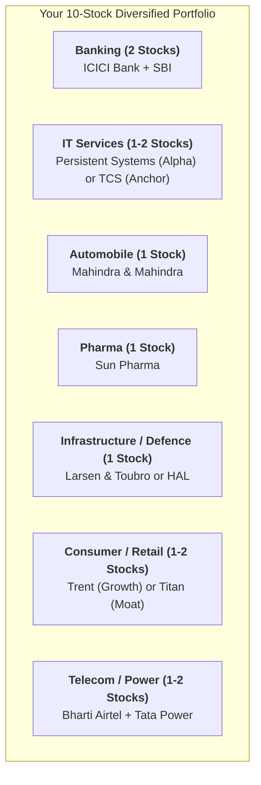

# Sector-by-Sector Blue Chip & Growth Playbook (Indian Markets)

A comprehensive Dalal Street institutional guide featuring the top 2–3 leaders across each core sector. Designed to help you select high-quality companies, understand their competitive moats, and identify ideal accumulation zones.

---

## 1. Information Technology & Software Services (IT)

| Stock Symbol | CMP (₹) | P/E Ratio | Category | The Core Moat & Growth Drivers | Ideal Accumulation Zone |
| :--- | :---: | :---: | :--- | :--- | :---: |
| **`TCS`** | ~₹3,950 | ~27.5x | **Blue-Chip Anchor** | **Fortress Cash Compounder:** India's largest IT titan. Massive free cash flow (> ₹40k Cr/year), 50%+ RoCE, generous dividend/buyback track record. | ₹3,800 – ₹3,880 (50/200 EMA) |
| **`PERSISTENT`** | ~₹6,048 | ~52.9x | **High-Growth Alpha** | **Enterprise AI & Software Engineering:** Fastest-growing mid-tier IT player. Q2 revenue surged +30.3% YoY with record $633M TCV deal bookings. | ₹5,800 – ₹5,920 (20 EMA pullback) |
| **`INFY`** | ~₹1,840 | ~27.0x | **Large-Cap Turnaround** | **Cloud & Digital Transformation:** Strong operating margins, expanding digital revenues, heavy DII institutional accumulation. | ₹1,760 – ₹1,810 (Near 50 EMA) |

---

## 2. Banking & Financial Services

| Stock Symbol | CMP (₹) | P/E Ratio | Category | The Core Moat & Growth Drivers | Ideal Accumulation Zone |
| :--- | :---: | :---: | :--- | :--- | :---: |
| **`ICICIBANK`** | ~₹1,398 | ~17.0x | **Private Banking Leader** | **Best-in-Class Asset Quality:** Uncontested private banking powerhouse. RoA at ~2.3%, Net NPA near 0.42%, steady 16%+ credit expansion. | ₹1,350 – ₹1,380 (50 EMA) |
| **`SBIN`** | ~₹815 | ~10.5x | **PSU Banking Titan** | **The Nation's Lender:** Lowest-cost deposit base in India, prime financier of corporate capex revival, robust RoE of ~17.2%. | ₹780 – ₹805 (Key horizontal floor) |
| **`HDFCBANK`** | ~₹690 | ~17.5x | **Deep-Value Compounder** | **Retail Branch Monolith:** Digestive merger phase winding down; massive CASA network and loan book expansion provide 3-year valuation upside. | ₹670 – ₹685 (Long-term base) |

---

## 3. Pharmaceuticals & Healthcare

| Stock Symbol | CMP (₹) | P/E Ratio | Category | The Core Moat & Growth Drivers | Ideal Accumulation Zone |
| :--- | :---: | :---: | :--- | :--- | :---: |
| **`SUNPHARMA`** | ~₹1,778 | ~34.8x | **Global Specialty Leader** | **Zero-Debt Specialty Giant:** High-margin US specialty products (Ilumya, Cequa, Winlevi) generating over $1 Billion in high-margin sales. | ₹1,740 – ₹1,780 (50 EMA floor) |
| **`CIPLA`** | ~₹1,365 | ~34.0x | **Domestic Formulation King** | **Respiratory Dominance:** Market leader in inhalers and domestic branded formulations with pristine balance sheet and steady cash flow. | ₹1,320 – ₹1,350 (200 EMA support) |
| **`APOLLOHOSP`** | ~₹6,900 | ~65.0x | **Healthcare Services Alpha** | **Hospital Beds & Digital Pharmacy:** Expanding bed capacity with rising ARPOB, paired with rapid growth in Apollo 24/7 omni-channel healthcare. | ₹6,600 – ₹6,750 (Pullback zone) |

---

## 4. Infrastructure, Capital Goods & Defence

| Stock Symbol | CMP (₹) | P/E Ratio | Category | The Core Moat & Growth Drivers | Ideal Accumulation Zone |
| :--- | :---: | :---: | :--- | :--- | :---: |
| **`LT`** | ~₹3,845 | ~27.0x | **National Infrastructure Titan**| **Monopoly EPC Execution:** Massive order backlog exceeding ₹5 Lakh Crores; prime beneficiary of India and Middle East capex cycles. | ₹3,700 – ₹3,780 (50 EMA) |
| **`HAL`** | ~₹4,850 | ~34.5x | **Defence Monopoly** | **Sovereign Fighter & Helicopter Maker:** Exclusive manufacturer of LCA Tejas Mk1A, Su-30 MKI upgrades, and indigenous military engines. | ₹4,550 – ₹4,700 (Horizontal support) |
| **`SIEMENS`** | ~₹7,100 | ~70.0x | **Industrial Automation Alpha** | **Electrification & Grid Modernization:** Key supplier for smart grids, high-speed rail/Vande Bharat propulsion, and enterprise data centres. | ₹6,700 – ₹6,900 (Key consolidation) |

---

## 5. Automobile & Auto Ancillaries

| Stock Symbol | CMP (₹) | P/E Ratio | Category | The Core Moat & Growth Drivers | Ideal Accumulation Zone |
| :--- | :---: | :---: | :--- | :--- | :---: |
| **`M&M`** | ~₹2,860 | ~18.5x | **SUV & Tractor Champion** | **#1 SUV Market Share:** Record order books (Scorpio, Thar Roxx, XUV700), dominant tractor margins (~40%+ share), aggressive EV lineup. | ₹2,780 – ₹2,840 (20/50 EMA band) |
| **`TATAMOTORS`** | ~₹885 | ~9.5x | **Commercial Vehicle & EV Leader**| **JLR Premium Turnaround:** Domestic electric passenger vehicle pioneer, dominant heavy commercial vehicle cash cow, debt-free trajectory. | ₹850 – ₹875 (200 EMA support) |
| **`BAJAJ-AUTO`** | ~₹9,800 | ~33.0x | **2-Wheeler & 3-Wheeler Titan** | **Global Export & Premiumization:** Dominant 3-wheeler monopoly, rapid expansion of Chetak EV scooter, and high export operating margins. | ₹9,300 – ₹9,550 (Pullback floor) |

---

## 6. Consumer, Retail & Lifestyle Discretionary

| Stock Symbol | CMP (₹) | P/E Ratio | Category | The Core Moat & Growth Drivers | Ideal Accumulation Zone |
| :--- | :---: | :---: | :--- | :--- | :---: |
| **`TRENT`** | ~₹3,025 | ~83.0x | **Retail Hypergrowth Engine** | **Value Fashion Disruption:** Zudio + Westside store additions driving 40%+ revenue growth with industry-leading RoCE (~30%). | ₹2,850 – ₹2,950 (Support shelf) |
| **`TITAN`** | ~₹3,350 | ~78.0x | **Luxury & Jewelry Moat** | **The Trust Monolith:** Tanishq capturing huge market share from unorganized jewelers; high-margin bridal and international expansion. | ₹3,200 – ₹3,280 (Strong multi-month base) |
| **`ITC`** | ~₹480 | ~26.0x | **FMCG Cash & Dividend Fortress**| **Unmatched Cash Machine:** High-margin cigarette cash generation reinvested into FMCG scale and hotels demerger value unlocking. | ₹465 – ₹475 (Value consolidation) |

---

## 7. Power, Energy Transition & Utilities

| Stock Symbol | CMP (₹) | P/E Ratio | Category | The Core Moat & Growth Drivers | Ideal Accumulation Zone |
| :--- | :---: | :---: | :--- | :--- | :---: |
| **`TATAPOWER`** | ~₹410 | ~32.0x | **Renewables & EV Infra Alpha** | **Integrated Clean Energy:** 10+ GW renewable energy generation, nationwide EV charging highway network, and rooftop solar leadership. | ₹390 – ₹405 (50 EMA support) |
| **`NTPC`** | ~₹320 | ~14.0x | **Baseload Utility Compounder** | **Thermal Cash Flow Funding Green:** Generates massive baseload cash while scaling green hydrogen and NTPC Green Energy subsidiary. | ₹305 – ₹315 (200 EMA floor) |
| **`POWERGRID`** | ~₹315 | ~16.0x | **Transmission Monopoly** | **100% Regulated Income:** Monopolistic inter-state power transmission grid with fixed ~15.5% regulated RoE and 4%+ dividend yield. | ₹300 – ₹310 (Defensive safe haven) |

---

## 8. Telecom & Digital Megacaps

| Stock Symbol | CMP (₹) | P/E Ratio | Category | The Core Moat & Growth Drivers | Ideal Accumulation Zone |
| :--- | :---: | :---: | :--- | :--- | :---: |
| **`BHARTIARTL`** | ~₹1,972 | ~40.0x | **Telecom Duopoly King** | **Pricing Power & ARPU Expansion:** Unprecedented pricing power with ARPU rising above ₹220, premium 5G upgrades, and fast-growing Africa arm. | ₹1,910 – ₹1,940 (20 EMA pullback) |
| **`RELIANCE`** | ~₹1,160 | ~22.0x | **India's Largest Conglomerate** | **Three-Engine Titan:** Jio Telecom + Reliance Retail + O2C refining cash flow funding new solar/battery giga-factories. | ₹1,130 – ₹1,155 (Major long-term support) |

---

## 🛡️ How to Pick from this Menu: The 8–10 Stock Construction Rule

### The 3 Core Execution Rules:
1. **Never buy more than 2 stocks from the same sector** to prevent sector-wide pullbacks from damaging your net worth.
2. **Never allocate less than ₹30,000 to any stock** (no odd-lots of 1–5 shares).
3. **Use the Staggered 50 EMA Strategy:** Start with 40% position, and add the remaining 60% only when the stock tests its 20 or 50 EMA on the Daily chart.
