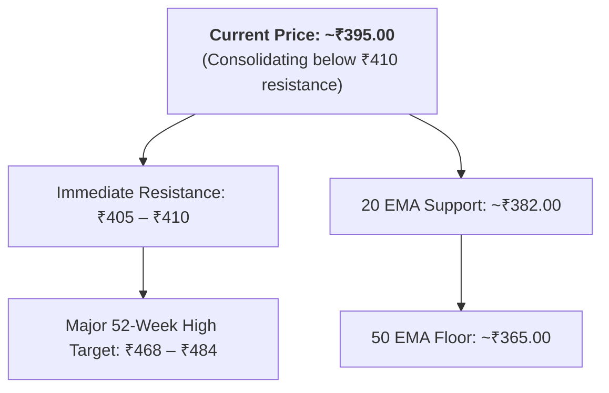
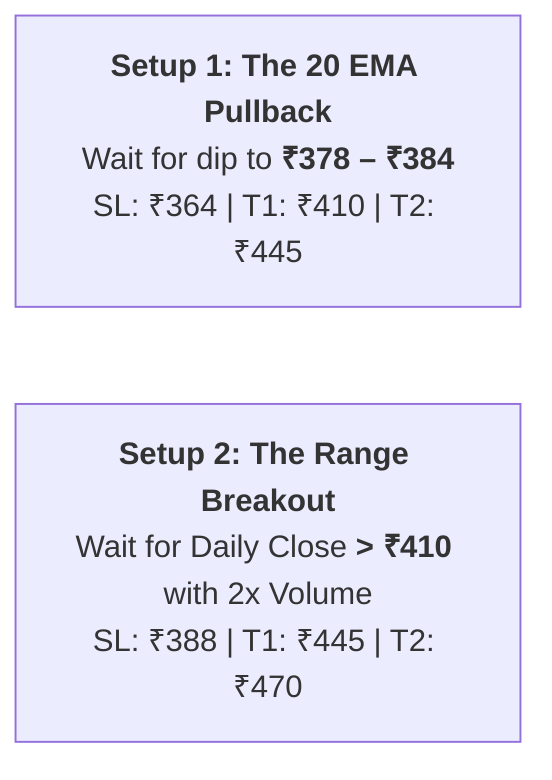

# Standard Engineering Technology Ltd (`SETL`): Technical & Fundamental Blueprint

**Ticker:** `SETL` (NSE) / `544333` (BSE) | **Current Market Price (CMP):** ~₹395.00  
**Former Name:** Standard Glass Lining Technology Ltd  
**Sector:** Capital Goods / Industrial Engineering (Pharma & Chemical Process Equipment)  
**Market Cap:** ~₹8,000 Crore (Mid-Cap) | **52-Week Range:** ₹105.65 – ₹468.15

---

## 1. Business Overview & Fundamentals

* **What the Company Does:** Designs and manufactures specialized glass-lined equipment, high-pressure chemical reactors, heat exchangers, and automated turnkey process systems for pharmaceutical APIs and specialty chemical manufacturers.
* **Operational Performance:** 
  * Recent quarterly revenue expanded **+43% YoY to upwards of ₹250+ Crore**.
  * Consolidated net profit grew **+26% YoY**, supported by an expanding domestic order book from pharma CAPEX expansions.
  * Promoter holding is stable and high at **60.47%**.
* **Valuation Warning (P/E ~90x):**
  * The stock trades at a premium **Price-to-Earnings (P/E) multiple of ~90x to 92x** and **~10x Price-to-Book (BV: ₹39.50)**.
  * *What this means:* High-growth expectations are already baked into the price. While momentum is strong, any quarter with a margin miss can trigger sharp 10%–15% pullbacks. Strict stop-loss discipline is mandatory.

---

## 2. Technical Chart Structure (Daily 1D Chart)

* **Trend Alignment:** The stock is in an established multi-month bull trend (`Price [₹395] > 20 EMA [₹382] > 50 EMA [₹365] > 200 EMA [₹315]`).
* **Price Action:** After a strong run from ₹105 to ₹468, the stock experienced a healthy 30% consolidation, bottomed at ₹340–₹360 in early October, and has now reclaimed its short-term moving averages.
* **RSI (14):** Sitting at **54** (healthy mid-range momentum, not overbought).

---

## 3. High-Probability Swing Trade Plan for SETL

Never buy in the middle of a range without a clear trigger. Two high-probability entries are available:

### Plan 1: The Pullback Entry (Preferred - Lower Risk)
* **Entry Zone:** **₹378.00 – ₹384.00** (on a 20 EMA retest and green reversal candle).
* **Stop-Loss:** **₹364.00** (placed below the 50-day EMA support). Risk = **₹18.00 per share** (~4.7%).
* **Target 1:** **₹410.00** (Immediate resistance retest $\rightarrow$ Reward: +₹28/sh | R:R = 1:1.55).
* **Target 2:** **₹445.00** (Pre-peak consolidation zone $\rightarrow$ Reward: +₹63/sh | R:R = 1:3.5).
* **Target 3:** **₹470.00** (Retest of 52-week all-time high).

### Plan 2: The Breakout Entry (Momentum Chaser)
* **Entry Trigger:** Buy ONLY if a daily candle **closes above ₹410.00** with volume $\ge 1.5\times$ the 20-day average volume.
* **Stop-Loss:** **₹388.00** (below the breakout base). Risk = **₹22.00 per share**.
* **Target 1:** **₹445.00** | **Target 2:** **₹475.00**.

---

### Position Sizing for ₹10,000 Portfolio Risk:
$$\text{Shares to Buy (Pullback Setup)} = \frac{₹10,000}{₹18 \text{ Risk}} = \mathbf{555 \text{ shares}}$$
* **Total Capital Allocation:** $555 \times ₹382 = \mathbf{₹2,12,010}$.
* **Profit at Target 1 (Sell 50% = 277 shares):** **+₹7,756** (Move SL on remaining to Breakeven).
* **Profit at Target 2 (Sell 278 shares):** **+₹17,514**.
* **Total Trade Profit:** **+₹25,270.00** (with risk eliminated after Target 1).

---

## 4. Summary Scorecard

| Parameter | Current Status | Assessment |
| :--- | :---: | :--- |
| **Trend (Daily 1D)** | `Price > 20 > 50 > 200 EMA` | 🟢 **Bullish** |
| **Fundamental Growth**| Revenue +43% YoY, PAT +26% | 🟢 **Strong Execution** |
| **Valuation (P/E ~90x)**| Expensive vs. peers | 🟡 **Requires Strict Stop-Loss** |
| **Actionable Decision**| Wait for dip to ₹380 OR close > ₹410 | 🟢 **Actionable Swing Setup** |
