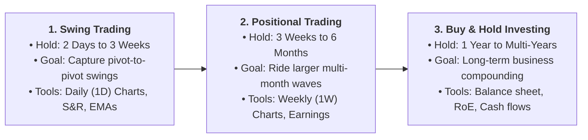
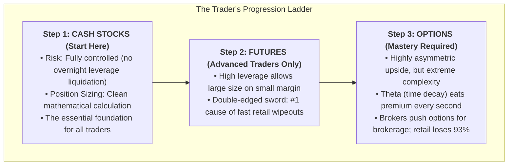
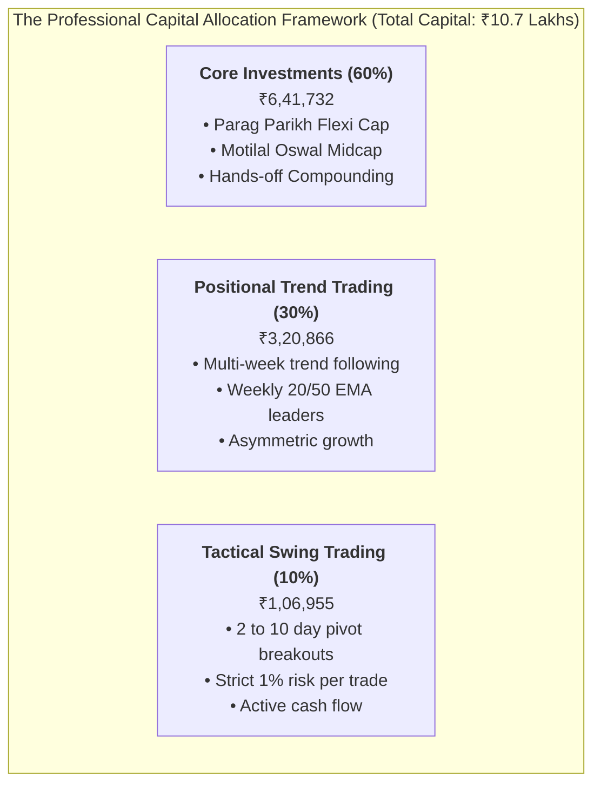
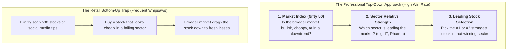

# Swing Trading Foundation Course (Part 1): The Professional Framework

A structured, foundational trading manual based on the institutional swing trading curriculum, synthesizing capital allocation, instrument selection, the top-down market framework, and execution hygiene.

---

## 1. The 3 Market Horizons: Where Do You Belong?

### Key Differences & Mental Separation:
1. **Never Mix Trading with Investing in the Same Bucket:**
   * A classic retail mistake is buying a stock for a "quick swing trade," and when it drops -20%, saying: *"I will just become a long-term investor."* (This is exactly how you got stuck with *Suzlon*, *SJVN*, and *Yes Bank*).
   * **Rule:** If a trade was entered as a swing, it **must exit** when the swing thesis fails.

---

## 2. The Instrument Hierarchy: Stocks vs. Futures vs. Options

### Why You Must Stick to Cash Stocks:
* As a developing swing trader, **100% of your trading must be in Cash Equities (Stocks)**.
* In cash stocks, you calculate your exact risk down to the rupee. If a stock gaps down 3%, you lose a small pre-calculated fraction. In futures or options, an overnight gap can wipe out months of profits in 1 minute.

---

## 3. The 60-30-10 Capital Allocation Blueprint

A sustainable trading career requires dividing your capital across three distinct buckets:

### How to Allocate Your ₹10,69,554 Capital:

| Bucket | Strategy | Target % | Capital (₹) | Objective |
| :--- | :--- | :---: | :---: | :--- |
| **Bucket 1** | **Long-Term Investments** | **60%** | **₹6,41,732** | Top Mutual Funds (Flexi Cap, Mid Cap) & Core Blue Chips. Builds compounding wealth. |
| **Bucket 2** | **Positional Trend Trading** | **30%** | **₹3,20,866** | Multi-week trend-following in sector leaders (Weekly 20/50 EMA holds). |
| **Bucket 3** | **Tactical Swing Trading** | **10%** | **₹1,06,955** | High-momentum 2-to-10 day pivot breakouts (strict 1% risk per trade). |

* **Why this preserves your mental health:** You never feel desperate to make money from tomorrow's swing trade because 60% of your wealth is compounding safely in long-term investments.

---

## 4. The Top-Down Approach vs. The Bottom-Up Trap

The single biggest reason retail swing traders suffer frequent whipsaws is **Bottom-Up Trading**.

### The 3 Steps of the Top-Down Method:
1. **Step 1: Check the Nifty 50 Index:** Is the Nifty trading above its 20-day EMA? If YES, the market tide is rising.
2. **Step 2: Scan Sector Indices:** Compare Nifty IT, Nifty Bank, Nifty Auto, and Nifty Pharma against the Nifty 50. Trade only in sectors demonstrating **Relative Strength** (making higher highs while Nifty consolidates).
3. **Step 3: Select the Leader:** Within the winning sector, pick the stock with the cleanest consolidation base and highest relative volume.

---

## 5. Discretionary Trading vs. Black-Box Trading Systems

* **System / Algo Trading:** Executes orders automatically based on coded rules. Removes human emotion, but struggles during changing market regimes.
* **Discretionary Trading (The Professional Approach):**
  * You follow strict technical rules (Entry triggers, Stop-Loss, Position Sizing), but use **human judgment to evaluate context**:
    * Is earnings coming out tomorrow? (Skip trade).
    * Is the broader market crashing on geopolitical news? (Sit in cash).
    * Is volume expanding or anemic? (Evaluate institutional footprint).
  * **Trade Management Advantage:** Discretionary traders can observe sudden selling pressure and exit early to protect capital, rather than waiting for a rigid stop-loss to be hit.

---

## 6. Platform, Tool & Broker Hygiene

1. **Keep Separate Accounts for Trading vs. Investing:**
   * If your investment portfolio (Reliance, HDFC Bank, Mutual Funds) and your active swing trades are in the exact same watchlist, you will constantly feel tempted to fiddle with long-term investments.
   * **Best Practice:** Keep long-term mutual funds in **Zerodha Coin** (or a separate demat account), and use your **Zerodha Kite equity account** strictly for active swing/positional setups.
2. **Charting Software:** Use TradingView on the **Daily (`1D`) timeframe** for analysis. Avoid staring at tick-by-tick charts during live market hours.
3. **Order Discipline:** Use **GTT (Good-Till-Triggered) Stop-Loss Limit orders** so your risk is locked into the exchange system and you don't rely on emotional manual execution.
