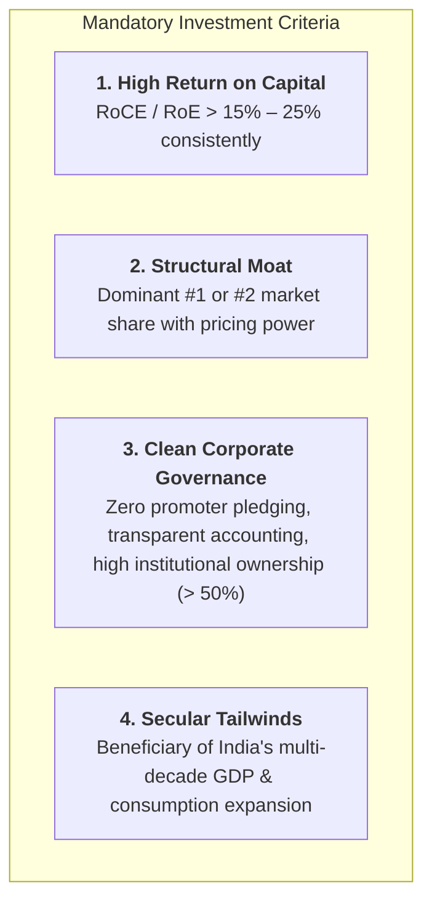
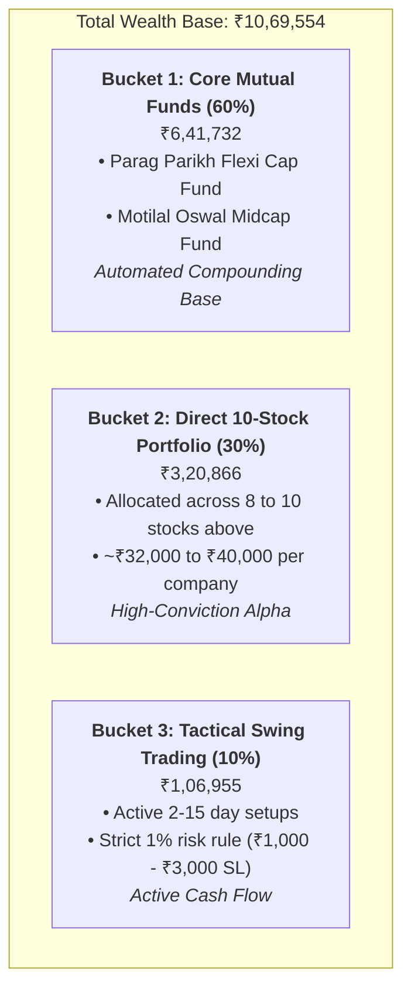
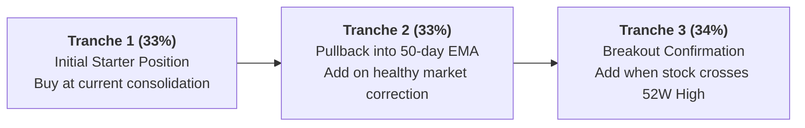

# Top 10–12 High-Conviction Investment Stocks: The Dalal Street Elite

A curated institutional watchlist and portfolio allocation blueprint for compounding wealth in the Indian equity markets with low volatility and high capital efficiency.

---

## 🏛️ The Selection Philosophy: Why These 10–12 Stocks?

To avoid repeating the penny-stock traps (*Suzlon*, *Mishtann*, *Alok Inds*, *EaseMyTrip*) and broken balance sheets (*Yes Bank*), every company in this list satisfies strict institutional filters:

---

## 📊 The Elite 10–12 Master Watchlist

| # | Stock Symbol | Sector / Industry | CMP (₹) | P/E Ratio | RoE / RoCE | Primary Business Moat & Growth Catalyst |
| :-: | :--- | :--- | :---: | :---: | :---: | :--- |
| **1** | **`ICICIBANK`** | Private Banking | ~₹1,398 | ~17.0x | 18.5% / 2.3% RoA | **India's Best-Run Bank:** Industry-leading asset quality (Net NPA 0.42%), resilient margins, 16%+ credit growth. |
| **2** | **`SBIN`** | PSU Banking | ~₹815 | ~10.5x | 17.2% | **The Nation's Banker:** Dominant low-cost CASA deposit franchise, primary beneficiary of India's corporate capex boom. |
| **3** | **`PERSISTENT`** | IT & Enterprise AI | ~₹6,048 | ~52.9x | 26.5% | **Top Mid-Tier IT Leader:** Q2 revenue surged +30.3% YoY with record $633M TCV deal wins; leader in Enterprise GenAI engineering. |
| **4** | **`TCS`** | IT Services Blue-Chip | ~₹3,950 | ~27.5x | 51.0% | **Fortress Cash Compounder:** Unmatched global delivery scale, massive free cash flows, 80%+ dividend/buyback payout policy. |
| **5** | **`TRENT`** | Retail & Fashion | ~₹3,025 | ~83.0x | 29.5% | **Consumption Powerhouse:** Zudio + Westside value fashion revolution; consistent 40%+ revenue growth and aggressive store rollout. |
| **6** | **`M&M`** | Automotive / SUVs | ~₹2,860 | ~18.5x | 21.0% | **#1 SUV & Tractor Maker:** Record order book (Scorpio, XUV700, Thar Roxx), market-leading tractor margins, strong EV pipeline. |
| **7** | **`LT`** | Infrastructure / EPC | ~₹3,845 | ~27.0x | 15.8% | **National Builder:** Record order backlog exceeding ₹5 Lakh Crores; monopoly-like execution in mega infra, defence, and green hydrogen. |
| **8** | **`BHARTIARTL`** | Telecom & Digital | ~₹1,972 | ~40.0x | 20.5% | **Duopoly Pricing Power:** Continuous ARPU growth (> ₹220+), premium 5G subscriber upgrades, and booming Africa digital business. |
| **9** | **`SUNPHARMA`** | Pharma & Specialty | ~₹1,778 | ~34.8x | 16.9% | **Global Specialty Leader:** Zero net debt, expanding high-margin US dermatology/ophthalmology drugs (Ilumya, Cequa, Winlevi). |
| **10**| **`TITAN`** | Luxury / Jewelry | ~₹3,350 | ~78.0x | 28.2% | **The Trust Monolith:** Tanishq continues capturing market share from unorganized jewelers; rapid international expansion. |
| **11**| **`TATAPOWER`** | Power & Clean Energy | ~₹410 | ~32.0x | 13.5% | **Green Energy Transition:** Integrated renewables player with 10+ GW solar/wind capacity, rooftop solar leadership, and EV charging. |
| **12**| **`ETERNAL`** | Quick Commerce / Tech | ~₹342 | ~85.0x | Expanding | **Hyperlocal Leader:** Blinkit is dominating India's quick-commerce grocery retail revolution; already in your portfolio at +34.6% profit. |

---

## 💰 Recommended Capital Allocation (For Your ₹10.7 Lakhs Base)

To achieve low-stress compounding while maintaining healthy active cash:

---

## 🎯 How to Enter: The "Staggered Dip-Buying" Strategy

Never invest 100% of your capital on day one. Markets move in waves. Use this institutional entry protocol:

### Technical Entry Zones to Watch (Daily Chart):
1. **`ICICIBANK`**: Accumulate around the **₹1,360–₹1,390** range (near its rising 50-day EMA).
2. **`PERSISTENT`**: Accumulate on pullbacks near **₹5,850–₹5,920** (20-day EMA support floor).
3. **`M&M`**: Ideal accumulation zone is **₹2,780–₹2,840**.
4. **`BHARTIARTL`**: Buy breakout above **₹1,975** or pullback to **₹1,910–₹1,930**.
5. **`SUNPHARMA`**: Strong support floor at **₹1,740–₹1,780** (50-day EMA).

---

## 🚫 The 4 Golden Rules for Your New Portfolio

1. **No Penny Stocks Ever Again:** Eliminate any stock with market cap < ₹10,000 Cr or stock price < ₹30.
2. **Minimum Size Rule:** Every stock purchase must be at least **₹30,000 to ₹40,000**. Never buy 1, 5, or 10 shares of low-value stocks.
3. **The 2-Stock Sector Ceiling:** Never hold more than 2 banks, 2 IT stocks, or 2 auto companies.
4. **Trailing Exit Rule:** If an investment stock violates its **200-day EMA on a weekly closing basis**, review the thesis and exit rather than holding through a 50% loss.
