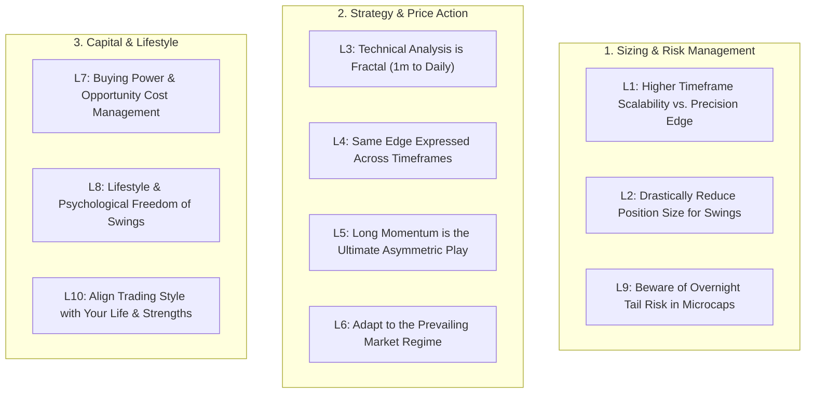

# 16 Years of Wall Street Trading Lessons: Practical Guide for Your Portfolio

A direct breakdown of the 10 core swing trading lessons from a veteran Wall Street proprietary trader (former Trillium trader with $100M+ career P&L), applied directly to your Zerodha portfolio, trading psychology, and recent exits.

---

## The 10 Lessons at a Glance

---

## Detailed Breakdown & Direct Mapping to Your Portfolio

---

### Lesson 1: Higher Timeframes Provide Scalability, But at the Expense of Precision
* **The Insight:** On a 1-minute or 5-minute chart, you can trade with surgical precision and exit in seconds. But you cannot scale millions of rupees without moving the market. Swing trading (Daily/Weekly) allows you to deploy ₹5 Lakhs, ₹50 Lakhs, or ₹5 Crores easily, but introduces overnight randomness and news variables.
* **Applied to You:** 
  * Trying to day-trade BSOFT on a 1-minute chart gave you false precision. You saw a ₹2 dip at 09:24 AM and panicked.
  * Moving to the **Daily (1D) timeframe** gives you the ability to calmly deploy ₹2 to ₹3 Lakhs per swing trade without stressing over every 50-paise fluctuation.

---

### Lesson 2: You Must Reduce Your Position Size Far More Than You Think
* **The Insight:** Day traders take a 20-cent or 50-paise stop-loss, so they load huge share size. When moving to multi-day swings, your stop-loss might be ₹15 to ₹30 away. You **cannot** use the same share quantity. Furthermore, stocks can gap overnight—they don't politely stop at your exit price.
* **Applied to You:**
  * In your portfolio, you held **₹1,04,448 in Jio Financial (17.4% weight)** and **₹95,118 in Wipro (15% weight)**.
  * When a stock moves against you by 20% to 27%, an oversized position destroys your psychology.
  * **The Rule:** Rebuild your position size around the **1% Account Risk Formula**:
    $$\text{Shares to Buy} = \frac{\text{₹10,000 Max Risk}}{\text{Entry} - \text{Stop-Loss}}$$
  * Smaller position size does not mean smaller profit—because swing targets (+10% to +20%) are 5x to 10x larger than intraday targets!

---

### Lesson 3: Technical Analysis is Fractal (1m to Daily Charts)
* **The Insight:** Human fear and greed do not change just because you zoom out. A Bullish Hammer, an EMA pullback, or a consolidation breakout on a 5-minute chart looks and acts **identically** on a Daily (`1D`) or Weekly (`1W`) chart.
* **Applied to You:**
  * You do not need a brand-new, complex system for swing trading.
  * The exact 20/50 EMA retest you saw on BSOFT on the Daily chart is the same retest institutions trade intraday. The only difference is patience.

---

### Lesson 4: Same Core Strategies Across Timeframes (Breakout & Mean Reversion)
* **The Insight:** Nearly all profitable trading boils down to two things:
  1. **Continuation Breakouts** (buying strength in an established trend).
  2. **Mean-Reversion Capitulation** (buying deep exhaustion at key structural support).
* **Applied to You:**
  * Our trade setup in **Bharti Airtel** (`BHARTIARTL`) is a classic *Continuation Breakout*.
  * Our trade setup in **Sun Pharma** (`SUNPHARMA`) is a classic *50 EMA Mean-Reversion Pullback*.
  * Stick to these two setups; master their execution.

---

### Lesson 5: Long Momentum is the King of Asymmetry (Kristjan Qullamaggie Model)
* **The Insight:** In a strong bull market, leading momentum stocks can look extended, double, and then double again. Traders with a "mean-reversion" mindset look at a stock that ran up 100% and think: *"It's too high, let me sell."* But often, the strongest phase of the move is just beginning.
* **Applied to You:**
  * **The Persistent Systems Example:** You sold your 60 shares at ₹5,554 thinking it was high. It rallied straight to **₹6,048+**!
  * **The Eternal (Zomato) Example:** You bought at ₹254, it reached ₹342 (+34.5%), and instead of panic selling, holding with a **20 EMA Trailing Stop (₹320)** allows you to capture the full multi-bagger momentum run!

---

### Lesson 6: You Must Know What Market Regime You Are Trading In
* **The Insight:** A momentum strategy that mints money for 6 months in a raging bull market will bleed capital if applied during a choppy or bear market. Even top traders (like Kristjan Qullamaggie in 2022) had to adapt when the regime shifted.
* **Applied to You:**
  * Late 2024–2026 saw a massive deflation in overvalued PSU and green-energy bubble stocks.
  * Strategies that worked in 2023 (blindly buying PSU dips in SJVN, Suzlon, Ircon) stopped working.
  * You must align your trades with current sector leadership (e.g., IT, Pharma, Private Banking) and avoid fighting the macro regime.

---

### Lesson 7: Buying Power & Opportunity Cost Management
* **The Insight:** An intraday trader recycles buying power in minutes. In swing trading, capital is committed for weeks. Every position tied up in a dead stock carries a massive **Opportunity Cost**—it prevents you from entering new, explosive setups.
* **Applied to You:**
  * You currently have **₹45,510 tied up in Yes Bank** (-26.9%), **₹34,859 tied up in SJVN** (-53.3%), and **₹26,680 tied up in Suzlon** (-50.5%).
  * That is **₹1,07,000+ of dead capital** sitting in broken, negative-trend stocks while leaders like Persistent Systems and Bharti Airtel made fresh 52-week highs!
  * **Cutting dead capital frees your buying power for active market winners.**

---

### Lesson 8: Lifestyle & Psychological Freedom of Swing Trading
* **The Insight:** Intraday prop trading at Trillium meant being glued to 6 screens for 7 hours a day, operating at maximum stress, and trading health for wealth. Swing trading frees you from the screen.
* **Applied to You:**
  * You do not need to sit and watch BSOFT tick by tick at 09:24 AM.
  * You only need **20 to 30 minutes in the evening** (07:00 PM) to check your Daily charts, update your GTT trailing stop orders in Zerodha, and let the market do the heavy lifting while you live your life.

---

### Lesson 9: Substantially More Tail Risk in Microcaps
* **The Insight:** When holding overnight, you lose real-time control. Especially in microcaps, sudden negative news, dilution, or promoter issues can cause a stock to open down 20% to 50% without giving you a chance to exit.
* **Applied to You:**
  * This is the exact mechanism that destroyed value in **Mishtann Foods (-58.9%)**, **Alok Industries (-67.6%)**, **EaseMyTrip (-62.8%)**, and **Inox Wind (-73.4%)**.
  * **The Institutional Rule:** Never hold speculative microcaps or penny stocks overnight. Focus 100% of your swing trading on liquid **Nifty 200 / F&O stocks**.

---

### Lesson 10: Find the Trading Style that Fits Your Life & Strengths
* **The Insight:** Some traders thrive on rapid-fire scalping. Others excel when given 24 hours to analyze a chart calmly. Transitioning to swing trading takes time—it requires learning patience, proper position sizing, and tolerating normal pullback noise.
* **Applied to You:**
  * Stop jumping between 1-minute intraday scalping and unmanaged long-term holding.
  * Adopt the **Core & Satellite Model**:
    * **Core (65%):** Automated wealth compounding in top Mutual Funds (Parag Parikh Flexi Cap, Motilal Oswal Midcap).
    * **Satellite (35%):** Calm, disciplined Daily-chart swing trading with strict 1% risk rules on market leaders.
