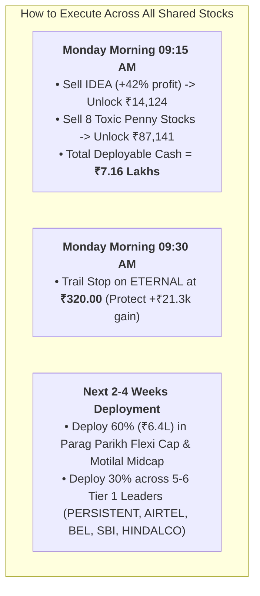

# Complete Market CMP & Action Guide: All Shared Stocks Audited

A consolidated master reference auditing all shared large-cap radar stocks, brokerage recommendations, and portfolio holdings with verified NSE Current Market Prices (CMP), institutional ratings, and actionable price levels.

---

## 🏛️ Master Price & Action Matrix (All Stocks Audited)

| # | Stock Symbol | Company Name | Sector | Verified CMP (₹) | Institutional Rating | Action Plan & Strategy | Accumulation / Trigger Zone | Stop-Loss / Target |
| :-: | :--- | :--- | :--- | :---: | :---: | :--- | :--- | :--- |
| **1** | **`BHARTIARTL`** | Bharti Airtel | Telecom | **₹1,972.00** | 🟢 Tier 1 Elite | **Long-Term & Swing Leader:** ARPU expansion, duopoly pricing power. Brokerage target ₹2,732. | Buy breakout > **₹1,975** or dip at ₹1,910–₹1,930 | SL: ₹1,895 \| Tgt: ₹2,220, ₹2,730 |
| **2** | **`BEL`** | Bharat Electronics | Defence | **₹370.00** | 🟢 Tier 1 Elite | **Defence Monopoly:** Zero debt, high order backlog. Circuit-proof momentum under ₹500. | Accumulate: **₹360 – ₹365** (20 EMA) | SL: ₹353 \| Tgt: ₹420, ₹460 |
| **3** | **`SBIN`** | State Bank of India | PSU Banking | **₹815.00** | 🟢 Tier 1 Elite | **Nation's Lender:** P/E ~10.5x, RoE 17.2%. Primary corporate capex financier. | Accumulate: **₹785 – ₹805** | SL: ₹768 \| Tgt: ₹900, ₹980 |
| **4** | **`TITAN`** | Titan Company | Luxury/Retail | **₹3,350.00** | 🟢 Tier 1 Elite | **The Trust Monolith:** Tanishq domestic & global expansion, capturing unorganized jewelry. | Accumulate: **₹3,220 – ₹3,280** | SL: ₹3,140 \| Tgt: ₹3,800, ₹4,000 |
| **5** | **`HINDALCO`** | Hindalco Industries | Metals/Alum | **₹885.00** | 🟢 Tier 1 Elite | **Global Aluminum Leader:** High beta, Novelis expansion. Brokerage target ₹1,100. | Accumulate: **₹855 – ₹875** (50 EMA) | SL: ₹830 \| Tgt: ₹980, ₹1,100 |
| **6** | **`SHRIRAMFIN`** | Shriram Finance | NBFC / Retail | **₹835.00** | 🟢 Tier 1 Elite | **Fastest-Growing NBFC:** Nifty 50 entrant, high commercial vehicle and MSME loan demand. | Accumulate: **₹810 – ₹825** | SL: ₹785 \| Tgt: ₹950, ₹1,020 |
| **7** | **`ETERNAL`** | Zomato Ltd | Tech/Retail | **₹342.50** | 🟢 Tier 1 Elite | **Quick-Commerce Moat:** You own 325 shares (+34.6%). Brokerage target ₹430. | **HOLD WITH TRAILING STOP** | **Trail SL: ₹320.00** \| Tgt: ₹430 |
| **8** | **`PERSISTENT`** | Persistent Systems | IT Services | **₹6,048.00** | 🟢 Tier 1 Elite | **Fastest IT Compounder:** Blowout Q2 revenue (+30.3%), $633M deal wins. | Accumulate: **₹5,850 – ₹5,940** (20 EMA) | SL: ₹5,760 \| Tgt: ₹6,500, ₹7,200 |
| **9** | **`KEI`** | KEI Industries | Capital Goods | **₹3,780.00** | 🟢 Tier 1 Elite | **Power Grid Cables:** Exceptional RoCE (> 24%), zero debt. Brokerage target ₹4,845. | Accumulate: **₹3,650 – ₹3,720** (200 EMA) | SL: ₹3,540 \| Tgt: ₹4,400, ₹4,845 |
| **10**| **`ADANIPORTS`** | Adani Ports & SEZ | Infra / Ports | **₹1,850.00** | 🟡 Tier 2 Solid | **Monopoly Port Network:** Heavy cash flows, expanding international maritime terminals. | Buy on pullback: **₹1,780 – ₹1,820** | SL: ₹1,720 \| Tgt: ₹2,100, ₹2,250 |
| **11**| **`EICHERMOT`** | Eicher Motors | Auto / 2W | **₹7,240.00** | 🟡 Tier 2 Solid | **Royal Enfield Monolith:** High margins, new 450cc/650cc model cycle outperformance. | Accumulate: **₹6,950 – ₹7,100** | SL: ₹6,750 \| Tgt: ₹8,000, ₹8,400 |
| **12**| **`COALINDIA`** | Coal India | Mining/Energy | **₹385.00** | 🟡 Tier 2 Solid | **High Dividend Utility:** Regulated volumes, 6%+ dividend yield, power demand hedge. | Accumulate: **₹370 – ₹380** | SL: ₹358 \| Tgt: ₹430, ₹460 |
| **13**| **`NTPC`** | NTPC Ltd | Power/Utility | **₹320.00** | 🟡 Tier 2 Solid | **Baseload Giant:** Cash flows funding NTPC Green Energy subsidiary. | Accumulate: **₹305 – ₹315** | SL: ₹295 \| Tgt: ₹365, ₹390 |
| **14**| **`NESTLEIND`** | Nestle India | FMCG | **₹1,167.00** | 🟡 Tier 2 Solid | **Defensive FMCG:** Safe compounding, high RoCE, steady packaged foods demand. | Accumulate: **₹1,120 – ₹1,150** | SL: ₹1,080 \| Tgt: ₹1,300, ₹1,380 |
| **15**| **`HEROMOTOCO`** | Hero MotoCorp | Auto / 2W | **₹5,170.00** | 🟡 Tier 2 Solid | **Rural Recovery:** 100cc/125cc commuter dominance + Vida EV expansion. | Buy on pullback: **₹4,950 – ₹5,050** | SL: ₹4,820 \| Tgt: ₹5,700, ₹6,000 |
| **16**| **`GODREJCP`** | Godrej Consumer | FMCG | **₹1,270.00** | 🟡 Tier 2 Solid | **FMCG Turnaround:** Home care margin growth. Brokerage target ₹1,400. | Accumulate: **₹1,220 – ₹1,250** | SL: ₹1,180 \| Tgt: ₹1,400, ₹1,480 |
| **17**| **`INDUSTOWER`** | Indus Towers | Telecom Infra | **₹382.00** | 🟡 Tier 2 Swing | **Dividend Play:** Brokerage target ₹532. Tied to Vodafone Idea solvency. | Swing Buy: **₹365 – ₹375** | SL: ₹350 \| Tgt: ₹440, ₹500 |
| **18**| **`HPCL`** | HPCL | Oil & Gas | **₹385.00** | 🟡 Tier 2 Swing | **Crude Beneficiary:** High marketing margins with crude at $70–$75. | Swing Buy: **₹370 – ₹378** | SL: ₹358 \| Tgt: ₹435, ₹460 |
| **19**| **`JSWSTEEL`** | JSW Steel | Metals / Steel | **₹1,246.00** | ⚪ Tier 3 Cyclical | **Capacity Expansion:** High domestic capex, but facing Chinese steel export dumping. | Trade breakout only > **₹1,270** | SL: ₹1,210 \| Tgt: ₹1,380 |
| **20**| **`TATASTEEL`** | Tata Steel | Metals / Steel | **₹167.50** | ⚪ Tier 3 Cyclical | **UK Transition:** European operations restructuring drag; domestic mills solid. | Accumulate: **₹158 – ₹164** | SL: ₹152 \| Tgt: ₹185, ₹195 |
| **21**| **`AXISBANK`** | Axis Bank | Private Banking | **₹1,217.00** | ⚪ Tier 3 Cyclical | **Credit Normalization:** Good retail franchise, but ICICI Bank offers superior RoA. | Accumulate: **₹1,160 – ₹1,190** | SL: ₹1,130 \| Tgt: ₹1,320 |
| **22**| **`KOTAKBANK`** | Kotak Mahindra Bank | Private Banking | **₹1,780.00** | ⚪ Tier 3 Cyclical | **Digital Digestion:** Steady balance sheet, but slower loan growth than ICICI. | Accumulate: **₹1,720 – ₹1,750** | SL: ₹1,680 \| Tgt: ₹1,950 |
| **23**| **`TECHM`** | Tech Mahindra | IT Services | **₹1,790.00** | ⚪ Tier 3 Cyclical | **Turnaround Story:** New CEO margin expansion plan, but Persistent grows faster. | Buy on dip: **₹1,710 – ₹1,740** | SL: ₹1,660 \| Tgt: ₹1,950 |
| **24**| **`IDEA`** | Vodafone Idea | Telecom | **₹11.77** | 🔴 High MTF / Spec | **YOU HOLD 1,200 SHARES (+42% PROFIT).** Brokerage target ₹19 is speculative. | **MARKET SELL MONDAY MORNING** | **LOCK +42% PROFIT (₹14,124 CASH)** |
| **25**| **`ASIANPAINT`** | Asian Paints | Paints/Chemicals | **₹2,850.00** | 🔴 Price War Trap | **Birla Opus Price War:** Losing market share and pricing power. Margins squeezed. | **AVOID / DO NOT BUY** | High opportunity cost |

---

## 🎯 Strategic Summary for Your ₹10.7 Lakhs Portfolio

### 🚫 The 3 Non-Negotiable Rules to Remember:
1. **Never buy more than 8 to 10 stocks total:** Do not buy all 25 stocks above. Stick to the **Tier 1 Elite (Airtel, Persistent, BEL, SBI, Titan, Hindalco, Shriram Finance)**.
2. **Minimum Allocation Rule:** Never buy less than **₹30,000 to ₹40,000** of any stock. No odd-lots of 1–5 shares.
3. **1% Risk Rule:** Never risk more than **₹2,500 to ₹3,000 per swing trade**.
