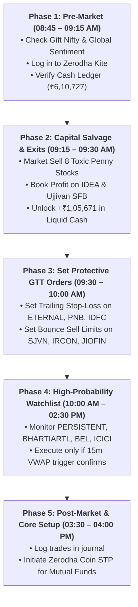
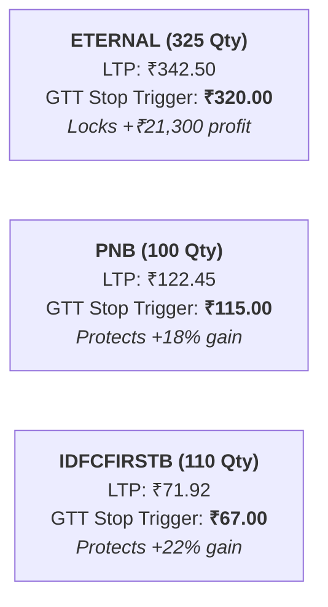

# Monday Execution Trade Plan: Dalal Street Operational Blueprint

A chronological, step-by-step battle plan for restructuring your Zerodha holdings, salvaging capital from toxic penny stocks, locking in profits, and deploying into institutional setups.

---

## ⏰ The Monday Timeline Overview

---

## 🔴 Phase 2: Exact Sell Orders (09:15 – 09:30 AM)

Place these orders as **Regular CNC Market (or Limit at LTP)** orders directly in Zerodha Kite:

### Basket A: Immediate Exits (Toxic Penny Stocks & Traps)
*Goal: Cut dead weight, stop ongoing capital erosion, and recover ₹87,139 in liquid cash.*

| Stock Symbol | Qty to Sell | Approx LTP (₹) | Expected Cash Recovered (₹) | Reason for Immediate Exit |
| :--- | :---: | :---: | :---: | :--- |
| **`SUZLON`** | 800 | ₹33.35 | **₹26,680.00** | Down -51%. Broken below 200 EMA; severe lower circuit risk. |
| **`YESBANK`** | 3,000 | ₹15.17 | **₹45,510.00** | Down -27%. Supreme Court AT-1 ruling (-₹5,217 Cr loss risk) + 3,130 Cr share dilution. |
| **`MISHTANN`** | 2,000 | ₹2.89 | **₹5,780.00** | Down -59%. Illiquid penny trap; governance red flags. |
| **`EASEMYTRIP`** | 850 | ₹5.93 | **₹5,040.50** | Down -63%. Continuous promoter selling and dilution. |
| **`ALOKINDS`** | 250 | ₹8.07 | **₹2,017.50** | Down -68%. Chronic loss-maker with zero operational turnaround. |
| **`KOHINOOR`** | 50 | ₹24.87 | **₹1,243.50** | Down -43%. Highly speculative microcap with broken chart. |
| **`INOXWIND`** | 10 | ₹55.41 | **₹554.10** | Down -73%. Tiny odd-lot holding adding unnecessary clutter. |
| **`NTPC`** | 1 | ₹315.55 | **₹315.55** | 1 single share odd-lot; sell to declutter portfolio. |
| **Subtotal (Basket A)** | — | — | **₹87,141.15** | **Direct Cash Unlocked** |

---

### Basket B: Profit Locks & Declutter Sells
*Goal: Realize existing gains before market volatility erodes them.*

| Stock Symbol | Qty to Sell | Your Avg (₹) | LTP (₹) | P&L % | Cash Realized (₹) | Action |
| :--- | :---: | :---: | :---: | :---: | :---: | :--- |
| **`IDEA`** | 1,200 | ₹8.28 | ₹11.77 | **+42.18%** | **₹14,124.00** | **Book Full Profit.** Cash out speculative gain. |
| **`UJJIVANSFB`** | 10 | ₹33.99 | ₹53.02 | **+55.99%** | **₹530.20** | **Book Full Profit.** 10-share micro odd-lot. |
| **`NHPC`** | 50 | ₹82.14 | ₹77.57 | -5.56% | **₹3,878.50** | **Sell to Declutter.** Odd-lot position. |
| **Subtotal (Basket B)** | — | — | — | — | **₹18,532.70** | **Direct Cash Unlocked** |

> [!IMPORTANT]
> **Total Liquid Cash Generated on Monday Morning: +₹1,05,673.85**  
> Combined with your existing realized cash (₹6,10,727.15), your **total deployable liquid cash expands to ~₹7,16,400.00**!

---

## 🛡️ Phase 3: Set Zerodha GTT Trailing Stop-Loss Orders (09:30 – 10:00 AM)

For the high-quality compounders you are keeping, set **GTT (Good-Till-Triggered) Stop-Loss Limit orders** in Zerodha Kite:

### Bounce Sell GTT Limit Orders (For Stage-4 Downward Drift Stocks):
Do not sell these into market open lows; instead, set GTT Sell Limit orders to catch dead-cat bounces into EMA resistance:
* **`SJVN` (650 shares):** Set GTT Sell Limit at **₹58.50 – ₹62.00** (retest of 50-day EMA). Unlocks ~₹38,000–₹40,000.
* **`IRCON` (100 shares):** Set GTT Sell Limit at **₹105.00 – ₹110.00** (retest of 50-day EMA). Unlocks ~₹10,500.
* **`JIOFIN` (Sell 50% = 195 shares):** Set GTT Sell Limit at **₹218.00 – ₹225.00**. Unlocks ~₹43,000.
* **`WIPRO` (Sell 50% = 175 shares):** Set GTT Sell Limit at **₹210.00 – ₹215.00**. Unlocks ~₹37,000.

---

## 🎯 Phase 4: High-Probability Watchlist & Rules (10:00 AM – 02:30 PM)

*Only execute if the technical entry trigger conditions are 100% satisfied:*

### 1. `PERSISTENT` (Swing Pullback Entry)
* **Trigger:** Stock pulls back into **₹5,880 – ₹5,940** (testing 20 EMA) and prints a bullish 15m hammer/engulfing candle with `LTP > VWAP`.
* **Hard Stop-Loss:** **₹5,760.00** (Risk per share = ₹150).
* **Target 1:** **₹6,250.00** | **Target 2:** **₹6,500.00**.
* **Position Size (₹3,000 Max Rupee Risk):** Buy **20 shares** (Allocated: ~₹1,18,000).

### 2. `BHARTIARTL` (Daily Breakout Entry)
* **Trigger:** 15m candle close above **₹1,975.00** with Relative Volume (RVOL ≥ 2.0).
* **Hard Stop-Loss:** **₹1,895.00** (Risk per share = ₹80).
* **Target 1:** **₹2,100.00** | **Target 2:** **₹2,220.00**.
* **Position Size (₹3,000 Max Rupee Risk):** Buy **37 shares** (Allocated: ~₹73,000).

### 3. `BEL` (Low-LTP High-Momentum Pullback Entry)
* **Trigger:** Retest of **₹360.00 – ₹365.00** demand zone holding above 15m VWAP.
* **Hard Stop-Loss:** **₹353.00** (Risk per share = ₹10).
* **Target 1:** **₹395.00** | **Target 2:** **₹420.00**.
* **Position Size (₹2,500 Max Rupee Risk):** Buy **250 shares** (Allocated: ~₹91,000).

---

## 📋 The Monday Morning Pre-Flight Checklist

Before you place your first order at 09:15 AM:
- [ ] Log in to Zerodha Kite by 08:50 AM.
- [ ] Verify you have active funds/holdings authorization (CDSL T-PIN verified).
- [ ] Place Basket A market exits first (`SUZLON`, `YESBANK`, `MISHTANN`, `EASEMYTRIP`, `ALOKINDS`, `KOHINOOR`, `INOXWIND`, `NTPC`).
- [ ] Place Basket B profit-booking exits (`IDEA`, `UJJIVANSFB`, `NHPC`).
- [ ] Check Zerodha "Funds" tab to verify cash balance has expanded to **~₹7.16 Lakhs**.
- [ ] Set GTT Trailing Stop-Loss on `ETERNAL` (₹320.00), `PNB` (₹115.00), and `IDFCFIRSTB` (₹67.00).
- [ ] Take a 15-minute break. Do NOT enter new trades before 10:00 AM.
