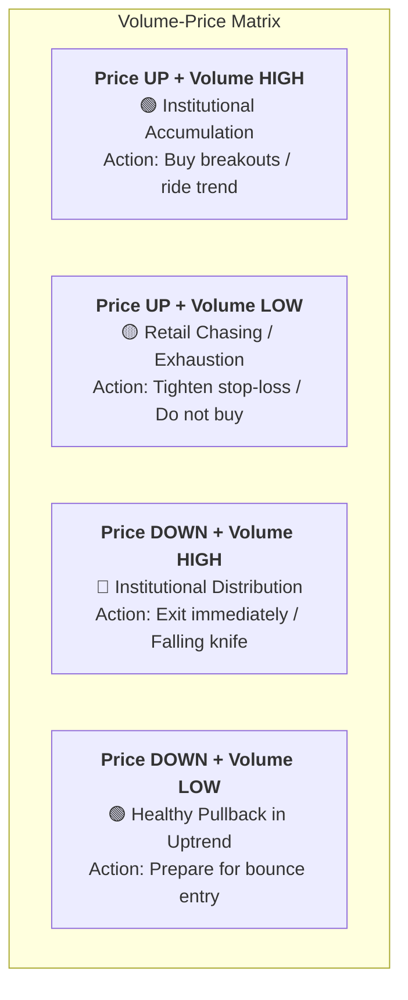
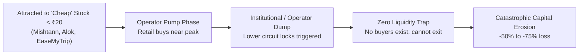
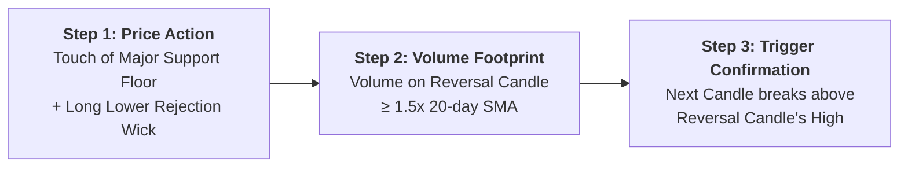
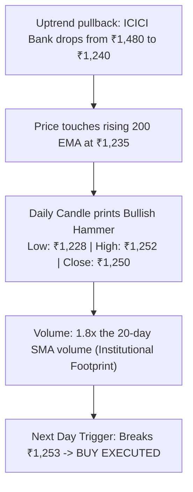
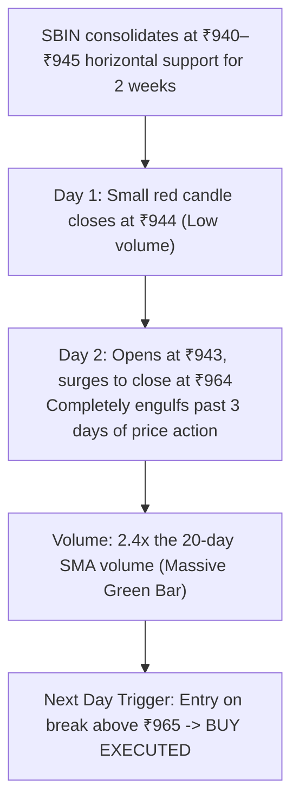
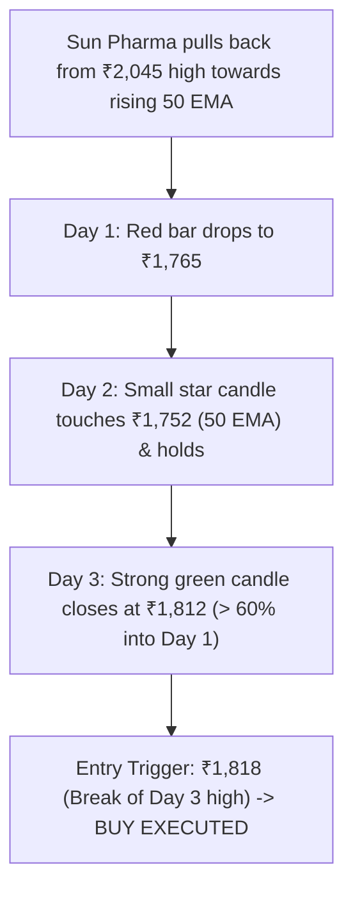
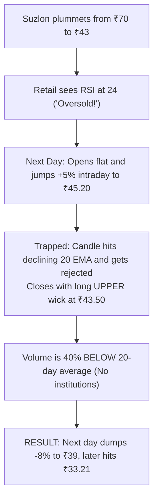

# Volume Analysis, Market Cap Traps & Bounce Confirmation Playbook

A complete reference manual on how institutional volume moves stock prices, how retail traders get trapped by Market Cap, RSI, and Moving Averages, and step-by-step real trade examples of true bounce confirmations vs. dead-cat traps.

---

## 1. What is Volume & Why It Dictates Every Stock Move

**Volume** is the total number of shares transacted (bought and sold) between market participants during a specific candle period (daily, hourly, 15-minute).

### The Core Truth About Volume:
1. **Price can be manipulated intraday; Volume cannot.** Large institutions (FIIs, DIIs, Mutual Funds) manage thousands of crores. When they buy, they cannot hide their footprints—they create massive volume surges.
2. **Volume precedes Price.** In high-probability bottoms, institutional accumulation shows up in expanding volume bars *before* the price launches into a multi-week rally.
3. **The Fuel Principle:** Price moving up without volume is like a car coasting on fumes—it will stall at the first resistance. Price moving up with heavy volume indicates institutional sponsorship.

```
       PRICE = The Vehicle 🚗
       VOLUME = The Fuel ⛽
```

---

### The 4 Volume-Price Quadrants



| Price Action | Volume Action | Market Psychology | Trading Action |
| :--- | :--- | :--- | :--- |
| **Price Rises 🟢** | **Volume Spikes (> 1.5x 20 SMA) 🟢** | Institutions are aggressively buying every offer. | **BUY / HOLD.** Strong trend confirmation. |
| **Price Rises 🟢** | **Volume Dries Up (< 20 SMA) 🔴** | Retail is buying; smart money is not participating. | **CAUTION.** Impending reversal or false breakout. |
| **Price Falls 🔴** | **Volume Spikes (> 1.5x 20 SMA) 🔴** | Large institutions are dumping massive blocks. | **EXIT / NEVER BUY.** Downward momentum is severe. |
| **Price Falls 🔴** | **Volume Dries Up (< 20 SMA) 🟢** | Sellers are exhausted; no panic selling. | **WATCHLIST.** Set alert for reversal candle at support. |

---

## 2. Why & How Traders Incur Catastrophic Losses

### Trap 1: The Market Capitalization & Penny Stock Trap



#### Why Penny Stocks and Microcaps Wipe Out Portfolios:
1. **The "It's Only ₹5" Optical Illusion:** A stock at ₹5 can drop to ₹2.50—that is a **-50% loss**. A stock at ₹2,000 dropping to ₹1,900 is only a **-5% loss**. Share price is irrelevant; percentage loss is everything.
2. **Lower Circuit Lockouts:** Unlike large-caps (Reliance, HDFC Bank) which trade millions of shares every minute, microcaps like *Mishtann Foods* or *Alok Industries* lock in 5% lower circuits with **zero buy orders**. You can place sell orders daily at 9:15 AM and remain trapped for weeks.
3. **The Asymmetry of Loss Recovery:**
   * A **-30% loss** requires a **+43% gain** to break even.
   * A **-50% loss** requires a **+100% gain** to break even.
   * A **-67% loss** (e.g., *Alok Industries* in your portfolio) requires a **+203% gain** just to get back your invested money!
   * A **-73% loss** (e.g., *Inox Wind* in your portfolio) requires a **+270% gain** just to reach ₹0 profit.

---

### Trap 2: The RSI "Oversold" Fallacy

* **The Common Mistake:** *"RSI dropped below 30, so the stock is oversold and must rebound. Let's buy!"*
* **The Institutional Reality:** In a strong downtrend (Stage-4 Markdown), **RSI < 30 is not a buy signal—it is an indicator of persistent selling pressure.**

```
Price: ₹80 ---> ₹65 (RSI 28 - "Oversold") ---> Retail Buys!
Price continues falling:
       ₹65 ---> ₹50 (RSI 25 - Still Oversold) ---> Retail Averages Down!
       ₹50 ---> ₹38 (RSI 22 - Deeply Oversold) ---> Retail Panics!
       ₹38 ---> ₹33 (RSI 20 - Fresh 52W Low) ---> Retail Capitulates at the Bottom!
```

#### Real Portfolio Example: `SUZLON`
* Suzlon dropped from ₹80 to ₹33.21. Along the way, its daily RSI dropped below 30 near **₹60.00**.
* Retail traders who bought at ₹60 because "RSI was oversold" suffered an additional **-45% drawdown** from their entry point.
* **The Correct Rule:** Never buy an oversold RSI directly. Wait for RSI to climb back **above 35–40**, print a **higher low**, and confirm with a daily price close above the 20-day EMA.

---

### Trap 3: The 50 EMA and 200 EMA Traps

The **200-day Exponential Moving Average (200 EMA)** is the dividing line between an institutional bull market and a bear market.

#### The 3 Major Moving Average Mistakes:
1. **Catching Falling Knives Below 200 EMA:** Buying a stock just because it is down 40% from all-time highs while it trades below a downward-sloping 200 EMA. 
2. **Ignoring the "Death Cross":** When the 50-day EMA crosses below the 200-day EMA, funds with algorithmic mandates are forced to liquidate their holdings.
3. **The "Resistance Ceiling" Trap:** In a downtrend, when a stock bounces 8%–12% and hits its declining 50 EMA, retail traders mistake it for a recovery. In reality, institutions use that exact level to **sell into strength**, sending the stock to fresh lows.

#### Real Portfolio Example: `SJVN`
* SJVN broke below its 200-day EMA near ₹100.
* Retail investors held and averaged down. Every bounce toward the 50 EMA was met with selling. The stock subsequently plummeted to **₹53.63** (-53.36% loss).

---

## 3. How to Confirm a True Bounce vs. A Dead-Cat Trap

A true swing trading bounce requires three consecutive confirmations before capital is risked:



---

## 4. Visual Candlestick Reversal Guide

*(Refer to [`candlestick_bounce_guide.jpg`](../visualizers/candlestick_bounce_guide.jpg) and [`candlestick_bounce_patterns.svg`](../visualizers/candlestick_bounce_patterns.svg) in the `visualizers/` folder for full graphical charts).*

### Pattern 1: The Bullish Hammer (Pin Bar)
* **Location:** At established horizontal support or the rising 200 EMA.
* **Candle Anatomy:** Small real body at the upper end; lower wick is **at least 2x to 3x the body height**; little to no upper wick.
* **Psychology:** Sellers drove prices down aggressively, but institutional buyers stepped in and forced the close near the day's high.

### Pattern 2: The Bullish Engulfing
* **Location:** At the conclusion of a multi-day pullback.
* **Candle Anatomy:** Day 1 is a red candle. Day 2 is a strong green candle whose body completely covers (engulfs) Day 1's red body.
* **Volume Rule:** Day 2 volume **must be noticeably higher (≥ 1.5x) than Day 1 volume**.

### Pattern 3: The Morning Star (3-Day Sequence)
* **Day 1:** Tall bearish red candle confirming the decline.
* **Day 2 (The Star):** Small indecisive body (doji or spinning top), gapping lower or opening flat. Signals seller exhaustion.
* **Day 3 (The Confirmation):** Large bullish green candle that closes **more than 50% into the body of Day 1**.

### Pattern 4: Dead-Cat Bounce (False Trap) vs. True Bounce

| Feature | Dead-Cat Bounce (FALSE TRAP) ❌ | True Swing Bounce (VALID SETUP) ✔ |
| :--- | :--- | :--- |
| **Candle Shape** | Long upper wick (rejected at 20 EMA) | Full green body closing near daily high |
| **Volume** | Low / Declining volume during the green day | **Volume expands ≥ 1.5x to 2x average** |
| **Moving Average** | Trapped below downward-sloping 20/50 EMA | Closes decisively above the 20 EMA |
| **Follow-Through** | Day 2 immediately gaps down or turns red | Day 2 breaks above Day 1 high with momentum |
| **Outcome** | Drops to fresh 52-week lows | Multi-week rally toward Target 1 & 2 |

---

## 5. Four Comprehensive Step-by-Step Trade Examples

---

### Trade Example 1: Bullish Hammer at 200 EMA Support
**Stock:** `ICICIBANK` (NSE)  
**Strategy:** Institutional Support Bounce with ATR Risk Sizing



#### Execution Parameters:
* **Account Capital:** ₹10,00,000
* **Max Capital at Risk (1% Rule):** ₹10,000
* **Setup:** Price tested the 200 EMA at ₹1,235 and printed a classic Hammer with a 22-point lower rejection wick.
* **Volume:** 1.8x average 20-day volume.
* **Entry Trigger:** Buy when price crosses ₹1.00 above the Hammer's high = **₹1,253.00**.
* **Stop-Loss:** ₹1,225.00 (0.5% below the Hammer's low of ₹1,228).
* **Risk per Share:** ₹1,253 - ₹1,225 = **₹28.00 per share**.
* **Position Size (Quantity):** 
  $$\text{Shares to Buy} = \frac{₹10,000}{₹28} = \mathbf{357 \text{ shares}}$$
* **Total Investment Value:** $357 \times ₹1,253 = ₹4,47,321$.
* **Target 1 (1:2 Risk/Reward):** $\text{Entry} + (2 \times \text{Risk}) = ₹1,253 + ₹56 = \mathbf{₹1,309.00}$.
* **Target 2 (1:3.5 Risk/Reward):** $\text{Entry} + (3.5 \times \text{Risk}) = ₹1,253 + ₹98 = \mathbf{₹1,351.00}$.

#### Trade Management & Result:
1. **Day 4:** Price reaches ₹1,309. **Sell 50% (178 shares).**
   $$\text{Realized Profit} = 178 \times ₹56 = \mathbf{+₹9,968.00}$$
2. **Stop-Loss Adjustment:** Move the Stop-Loss on remaining 179 shares to **Cost Price (₹1,253.00)**. Trade is now **100% risk-free**.
3. **Day 11:** Price rallies to Target 2 at ₹1,351. **Sell remaining 179 shares.**
   $$\text{Realized Profit} = 179 \times ₹98 = \mathbf{+₹17,542.00}$$
4. **Total Trade Profit:** $₹9,968 + ₹17,542 = \mathbf{+₹27,510.00}$ (+2.75% account growth with zero risk after Day 4).

---

### Trade Example 2: Bullish Engulfing with 2x Volume Spike
**Stock:** `SBIN` (State Bank of India)  
**Strategy:** Base Consolidation Breakout & Institutional Absorption



#### Execution Parameters:
* **Account Capital:** ₹10,00,000 | **Max Risk (1%):** ₹10,000
* **Setup:** A 3-week base at ₹940 was defended with a Bullish Engulfing green candle closing at ₹964.
* **Volume:** 2.4x average volume, indicating institutional buying.
* **Entry Trigger:** ₹966.00 (break above engulfing candle high).
* **Stop-Loss:** ₹938.00 (below the base low of ₹940).
* **Risk per Share:** ₹966 - ₹938 = **₹28.00**.
* **Position Size (Quantity):** 
  $$\text{Shares to Buy} = \frac{₹10,000}{₹28} = \mathbf{357 \text{ shares}}$$
* **Target 1 (1:2 R:R):** ₹966 + ₹56 = **₹1,022.00**.
* **Target 2 (1:3 R:R):** ₹966 + ₹84 = **₹1,050.00**.

#### Trade Management & Result:
* Stock hit Target 1 at ₹1,022 in 7 trading days. 50% booked (+₹9,968). Stop trailed to ₹966.
* Stock hit Target 2 at ₹1,050 in 16 trading days. Remainder booked (+₹14,952).
* **Total Profit:** **+₹24,920.00**.

---

### Trade Example 3: Morning Star Reversal at 50 EMA
**Stock:** `SUNPHARMA` (Sun Pharmaceutical)  
**Strategy:** 50-day EMA Sector Leadership Pullback



#### Execution Parameters:
* **Account Capital:** ₹10,00,000 | **Max Risk (1%):** ₹10,000
* **Setup:** Morning star completed right on top of the rising 50 EMA support shelf.
* **Entry Trigger:** ₹1,818.00.
* **Stop-Loss:** ₹1,745.00 (below the star low of ₹1,752).
* **Risk per Share:** ₹1,818 - ₹1,745 = **₹73.00**.
* **Position Size (Quantity):** 
  $$\text{Shares to Buy} = \frac{₹10,000}{₹73} = \mathbf{136 \text{ shares}}$$
* **Target 1 (1:2 R:R):** ₹1,818 + ₹146 = **₹1,964.00**.
* **Target 2 (1:3.2 R:R):** ₹1,818 + ₹234 = **₹2,052.00**.

#### Result:
* Target 1 reached in 8 sessions (+₹9,928). Trailing stop trailed behind the 20-day EMA until Target 2 hit (+₹15,912).
* **Total Profit:** **+₹25,840.00**.

---

### Trade Example 4: Dead-Cat Bounce (How the Disciplined Trader AVOIDED The Trap)
**Stock:** `SUZLON`  
**Scenario:** The False Bounce Trap That Wiped Out Retail



#### Why the Disciplined Trader Refused to Buy:
1. **Upper Wick Rejection:** The candle showed heavy intraday selling by institutions who used the +5% bounce to exit.
2. **Volume Divergence:** Volume on the green day was tiny compared to previous red days.
3. **Trend Structure:** Stock was trading below a downward-sloping 20, 50, and 200 EMA.
4. **Outcome of Discipline:** By waiting for confirmation, the disciplined trader avoided buying at ₹44. The stock subsequently plunged to ₹33.21, **saving ₹25,000+ in capital destruction**.

---

## 6. Pre-Execution Quick Verification Card

Before executing any bounce trade, ensure every item is checked:

```
[ ] 1. Location: Price is at verified horizontal support or 200 EMA.
[ ] 2. Candlestick: Hammer / Bullish Engulfing / Morning Star confirmed on daily close.
[ ] 3. Volume: Volume on reversal day is ≥ 1.5x the 20-day average.
[ ] 4. Trigger: Buy order is placed ABOVE the high of the reversal candle (never anticipatory).
[ ] 5. Stop-Loss: Placed 0.5% below the lowest wick of the pattern.
[ ] 6. Position Size: (₹10,000 Risk) ÷ (Entry - Stop-Loss) calculated and strictly adhered to.
```
