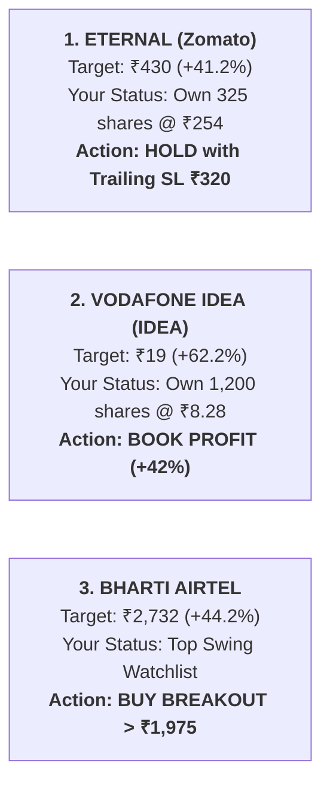

# Brokerage Radar: Forensic Analysis of 21 High-Upside Stock Picks

An institutional audit of the latest brokerage research reports, categorizing the 21 high-upside recommendations into **High-Conviction Winners**, **Tactical Turnarounds**, and **Dangerous Retail Traps**.

---

## 🏛️ Executive Summary: The 3 Direct Hits for Your Portfolio

---

## 🔍 Category 1: The Elite Institutional Winners (Safe Compounders)

These companies possess genuine structural moats, clean balance sheets, and real earnings growth supporting their brokerage targets:

| Stock | CMP (₹) | Brokerage Target (₹) | Upside % | Institutional Thesis & Key Drivers | Mentor Verdict |
| :--- | :---: | :---: | :---: | :--- | :---: |
| **`Bharti Airtel`** | ~₹1,972 | **₹2,732** | **+44.2%** | ARPU rising toward ₹230–₹250; premium 5G monetization; booming Africa mobile money. | 🟢 **TOP PICK:** Buy on pullbacks to ₹1,910 or breakout > ₹1,975. |
| **`Eternal` (Zomato)** | ~₹342 | **₹430** | **+41.2%** | Blinkit quick commerce hypergrowth; market share dominance; Swiggy IPO benchmark re-rating. | 🟢 **KEEP & RIDE:** You hold 325 shares. Trail stop at ₹320. |
| **`KEI Industries`** | ~₹3,780 | **₹4,845** | **+25.1%** | India's power transmission capex and solar installations require massive high-voltage cables. RoCE > 24%. | 🟢 **BUY ON PULLBACK:** High-quality industrial compounder. |
| **`Hindalco`** | ~₹690 | **₹1,100** | **+24.2%** | Global aluminum upcycle + Novelis automotive sheet expansion. Low debt, highly liquid F&O titan. | 🟢 **STRONG SWING:** High beta metal momentum leader. |
| **`Godrej Consumer`** | ~₹1,270 | **₹1,400** | **+63.5%** | Rural FMCG recovery, margin expansion in home care (Goodknight) and hair care. | 🟢 **DEFENSIVE BUY:** Steady 15% compounder. |

---

## ⚡ Category 2: Tactical Turnarounds & Event-Driven Plays (Handle with Care)

| Stock | CMP (₹) | Brokerage Target (₹) | Upside % | The Real Story Behind the Target | Mentor Verdict |
| :--- | :---: | :---: | :---: | :--- | :---: |
| **`Vodafone Idea`** | ~₹11.77 | **₹19.00** | **+62.2%** | Target assumes government relief on AGR dues and ₹25,000 Cr bank loan sanction. High debt risk. | 🟡 **BOOK PROFIT:** You are up +42%. Do not gamble on government mercy. |
| **`Indus Towers`** | ~₹382 | **₹532** | **+39.3%** | Cash flow and dividend recovery depend heavily on Vodafone Idea clearing past dues. | 🟡 **SWING ONLY:** Trade between ₹365 support and ₹440 resistance. |
| **`Swiggy`** | *Upcoming* | **₹280 – ₹350** | *IPO* | Direct competitor to Zomato. IPO pricing will benchmark both companies' quick commerce valuations. | 🟡 **MONITOR IPO:** Compare metrics against Eternal before bidding. |
| **`NTPC Green Energy`**| *Upcoming*| **₹100.00** | **+18.6%** | Pure-play renewable subsidiary of NTPC. Beneficiary of sovereign solar/wind tenders. | 🟡 **APPLY IN IPO:** Good long-term green utility play. |
| **`HPCL`** | ~₹385 | **₹435** | **+27.6%** | Beneficiary of low crude oil ($70–$75/bbl) boosting marketing margins. | 🟡 **TACTICAL SWING:** Sensitive to crude price spikes. |

---

## 🚫 Category 3: The Traps & High-Risk Anomalies (AVOID)

| Stock | Brokerage Target | The Trap / Red Flag | Why Retail Gets Burned |
| :--- | :---: | :--- | :--- |
| **`BALCO` (+1,771.3%)** | Target ₹320 | **Statistical Demerger/Stub Anomaly.** BALCO is a subsidiary of Vedanta (VEDL). The +1,771% is not an accessible, liquid retail stock. | Retail sees "+1,700%" and buys penny junk thinking it will 18x. Avoid! |
| **`Asian Paints` (+37.8%)** | Target ₹3,180 | **Structural Margin Compression.** Grasim (Birla Opus) and JSW Paints are engaged in an aggressive price war for market share. | Never fight a price war. Asian Paints' margins will remain pressured for multiple quarters. |
| **`Paytm` (+35.4%)** | Target ₹2,250 | **Regulatory Overhang.** Business model recovering from RBI payment bank sanctions. | High opportunity cost when clean lenders like `ICICIBANK` and `SBIN` offer safer compounding. |

---

## 🎯 Direct Action for Your Monday Morning Execution:

1. **`Eternal` (Hold):** Keep your 325 shares. The ₹430 target confirms institutional confidence. Lock in your stop-loss at **₹320.00** to protect ₹21,300 in profit.
2. **`Vodafone Idea` (Sell/Book Profit):** The brokerage target of ₹19 is an optimistic multi-year bull case. Sell on Monday at ₹11.77 to lock your **+42.18% gain (₹14,124 cash)** into your account.
3. **`Bharti Airtel` (Buy on Setup):** The ₹2,732 target (+44%) matches our research. Enter long on daily close above **₹1,975**.
