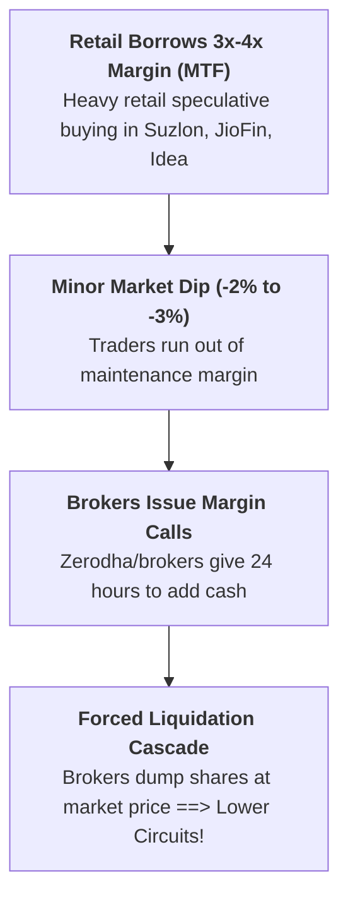
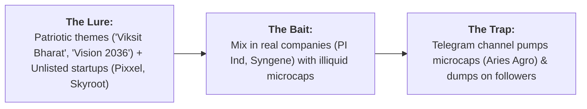

# Institutional Analysis: MTF Leverage Risks, Blue-Chip Radar, and Social Media Scams

A forensic breakdown of the Margin Trading Facility (MTF) exposure data, the 17 large-cap radar stocks, and the reality behind social media "Viksit Bharat" penny stock lists.

---

## 🚨 1. The MTF Warning: Why SUZLON, JIOFIN & IDEA Are Vulnerable

The list of **"Top 10 Stocks with Highest MTF Exposure"** contains 3 stocks directly from your Zerodha portfolio:

### Why High MTF Exposure Matters for Your Portfolio:
1. **`SUZLON` (#5 on MTF List):**
   * High MTF exposure means retail traders have borrowed hundreds of crores on margin to buy Suzlon.
   * When Suzlon drops, brokers automatically dump leveraged positions, accelerating lower circuit crashes. This confirms why **selling Suzlon on Monday morning is essential**.
2. **`VODAFONE IDEA` (#10 on MTF List):**
   * Massively leveraged by retail margin traders. Any negative headline triggers margin liquidation. 
   * **Action:** Book your +42% profit on Monday morning.
3. **`JIO FINANCIAL` (#6 on MTF List):**
   * Heavy retail margin overhang has kept the stock trapped below the 200 EMA (₹267). 
   * **Action:** Trim 50% on bounce to ₹218–₹225 to eliminate leverage drag.
4. **Blue Chips with High MTF (`HDFC Bank`, `Reliance`, `L&T`, `BEL`, `SBI`):**
   * These are institutional giants. Domestic mutual funds (DIIs) easily absorb retail margin selling, making high MTF safe for these 5 companies.

---

## 🛑 2. Scam Alert: Deconstructing the "Viksit Bharat / Telegram" Trap

The third block you shared ends with:  
`"For my full list join telegram link in bio Dis-no buy sell #StocksToBuy #pennystock #multibagger"`

### Why You Must Ignore This Channel:
* **Unlisted Names:** *Pixxel* and *Skyroot Aerospace* are private venture-backed startups; you cannot buy them on Zerodha or NSE.
* **The Psychology:** This is the exact format used to push **`Mishtann Foods` (-59%)**, **`Alok Industries` (-68%)**, and **`EaseMyTrip` (-63%)** onto retail investors.
* **Rule:** Never take investment advice from Telegram channels using hashtags like `#pennystock` or `#multibagger`.

---

## 🏆 3. Analysis of the 17 Large-Cap Radar Stocks

| Tier | Stock Symbols | Institutional Verdict |
| :--- | :--- | :--- |
| 🟢 **Tier 1: Elite Growth & Moat Leaders (Buy / Accumulate)** | **`Bharti Airtel`**, **`BEL`**, **`SBI`**, **`Titan`**, **`Hindalco`**, **`Shriram Finance`** | **The Real Champions:** Clean balance sheets, high return ratios, and institutional backing. Already featured in your core portfolio watchlists. |
| 🟡 **Tier 2: Solid Defensives & Cash Generators (Hold / SIP)** | **`Adani Ports`**, **`Eicher Motors`**, **`NTPC`**, **`Coal India`**, **`Nestle India`** | **Stable Performers:** Reliable dividends and cash flow, but slightly lower capital appreciation velocity than Tier 1. |
| ⚪ **Tier 3: Cyclicals & Slower Laggards (Trade Only on Breakouts)** | **`Tata Steel`**, **`JSW Steel`**, **`Axis Bank`**, **`Kotak Bank`**, **`Tech Mahindra`**, **`Hero Moto`** | **Commodity/Cyclical:** Tata Steel and JSW Steel are dependent on China steel dumping; Kotak Bank faces margin normalization. |
